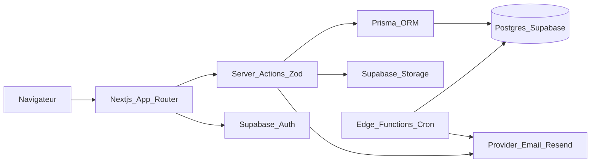
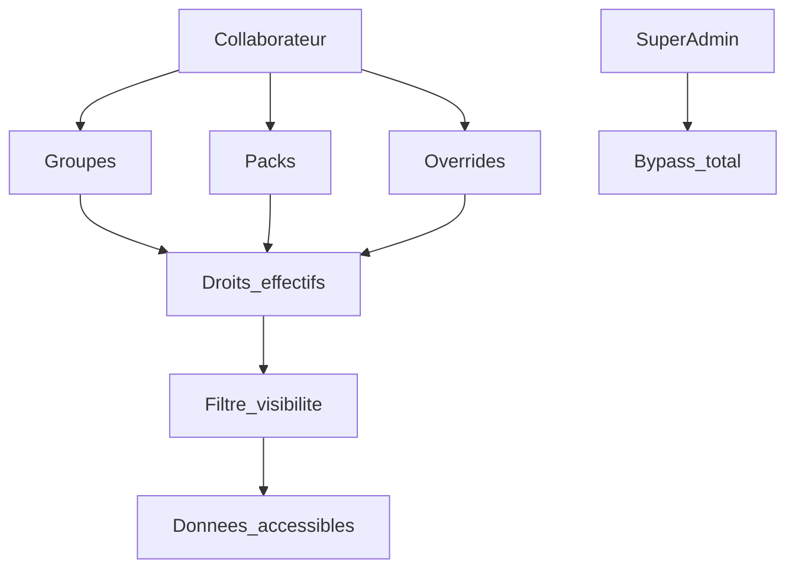
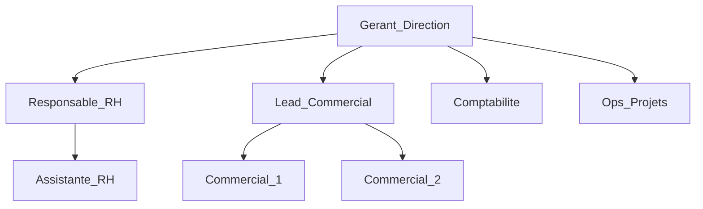
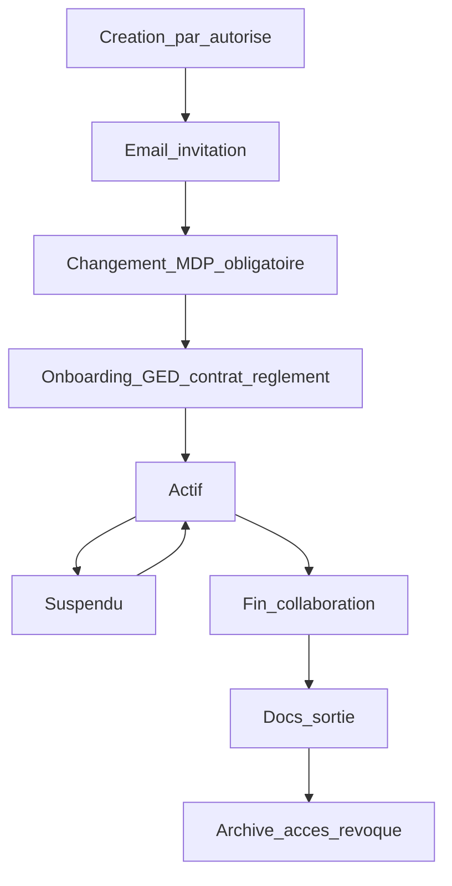
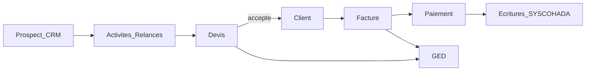

# Cahier des charges — ERP MSK CREATION

| Champ | Valeur |
|---|---|
| Document | Cahier des charges fonctionnel & technique |
| Produit | ERP métier interne MSK CREATION |
| Version | 1.5-draft |
| Date | 2026-10-08 |
| Statut | Brouillon structurant — à peaufiner jusqu’au gel |
| Périmètre juridique / fiscal | Mali — SYSCOHADA–AUDCIF, FCFA (XOF), TVA 18 %, DGI, INPS, patente |
| Stack cible | Next.js 15 (App Router) · React 19 · **Prisma** · Supabase (Auth, Postgres, Storage, Edge Functions) · Tailwind / charte MSK |
| Nature | Logiciel **interne** (non commercialisé). Backup SaaS éventuel hors scope (branche séparée). |

---

## Table des matières

0. [Métadonnées, glossaire, périmètre](#0-métadonnées-glossaire-périmètre)
1. [Vision & page d’accueil collaborateur](#1-vision--page-daccueil-collaborateur)
2. [Architecture cible (single-tenant)](#2-architecture-cible-single-tenant)
3. [Identité, accès, groupes, RBAC](#3-identité-accès-groupes-rbac)
4. [GED & dossiers automatiques](#4-ged--dossiers-automatiques)
4bis. [Signatures, cachets & organigramme](#4bis-signatures-cachets--organigramme)
5. [CRM (module critique)](#5-crm-module-critique)
6. [Commercial — Clients, devis, factures](#6-commercial--clients-devis-factures)
7. [RH, paie, INPS, documents RH](#7-rh-paie-inps-documents-rh)
8. [Projets, dépenses, interventions, patrimoine, stocks](#8-projets-dépenses-interventions-patrimoine-stocks)
9. [Comptabilité SYSCOHADA](#9-comptabilité-syscohada)
10. [Notifications, automatisations, audit](#10-notifications-automatisations-audit)
11. [UX, navigation, charte](#11-ux-navigation-charte)
12. [Non-fonctionnel & sécurité](#12-non-fonctionnel--sécurité)
13. [Évaluation Supabase](#13-évaluation-supabase)
14. [Roadmap phasée](#14-roadmap-phasée)
15. [Annexes](#15-annexes)

---

## 0. Métadonnées, glossaire, périmètre

### 0.1 Objectif du document

Ce cahier des charges décrit **de bout en bout** comment la plateforme ERP MSK CREATION doit fonctionner : modules, flux, droits, automatisations, documents, comptabilité, GED, CRM multi-commerciaux, RH/paie/INPS, stocks, projets et états financiers.

Il sert de **référence unique** pour le développement, les tests d’acceptation et le paramétrage métier. Il remplace progressivement l’organisation manuelle actuelle (Excel + SharePoint + Word/PDF).

### 0.2 Sources analysées

#### Fichiers métier (`docs/`)

| Fichier / source | Domaine | Statut repo |
|---|---|---|
| `CRM_Prospection_MSK.xlsx` / CSV PROSPECTS | CRM, scripts, import | Conservé (`docs/`) |
| `docs/msk/team/*` | Photos organigramme / seed | Conservé |
| `docs/msk/favicon*` | Favicons | Conservé |
| Devis Marinas / catalogue services / exemples PNG | Prix catalogue, gabarits PDF | **Intégrés** (seed + `src/lib/pdf`) — PDF/PNG d’exemple retirés du repo |
| Autres fichiers métier historiques (contrats, paie, journaux…) | Analyse CDC Phase -1 | Hors repo (sources externes) |

#### Organisation SharePoint observée (captures)

Arborescence type année `2026` :

1. **Comptabilité annuelle** → Comptabilité / Impôts (patente) / Remboursements trop-perçus / Relevés ECOBANK (2 comptes)
2. **Comptabilité mensuelle** → Factures & reçus (par mois → FACTURES_REÇUES / REÇUS DE PAIEMENTS → catégories 01_LOGICIELS … 05_ÉLECTRICITÉ) ; Personnel paie & charges (fiches de paie par collaborateur / mois ; charges sociales ; A VALIDER) ; Dépenses de déplacement / missions (projet + justificatifs datés)
3. **Clients**
4. **Modèles facture & devis** (Word)
5. **Échange-Collaborateurs** (cahier des charges, charte, formations, intégration, projets, rapports hebdo, recrutement, vacances, entretiens, dossier collab, stocks, bien-être…)

L’ERP **ne doit pas recopier aveuglément** les incohérences Excel/SharePoint : il doit **structurer**, **automatiser** et **relier** les objets métier.

### 0.3 Glossaire

| Terme | Définition |
|---|---|
| Collaborateur | Toute personne physique liée à MSK (salarié, stagiaire, prestataire) pouvant avoir un compte et/ou un dossier RH |
| Compte utilisateur | Identité de connexion Supabase Auth liée à une fiche `users` |
| Super Admin | Compte plateforme unique, indestructible, privilège total |
| Groupe | Ensemble organisationnel (ex. Direction, Commerciaux) — multi-appartenance possible |
| Pack de permissions | Jeu de capacités réutilisable (ex. Admin plateforme, Admin RH) |
| Override | Permission accordée ou retirée individuellement sur un compte |
| Owner (CRM) | Collaborateur responsable d’une opportunité / organisation |
| GED | Gestion électronique de documents (Storage + métadonnées) |
| Gabarit | Modèle configurable pour générer PDF/DOCX (devis, contrat, paie…) |
| SYSCOHADA | Système comptable OHADA révisé applicable au Mali |
| Pipeline | Étapes commerciales configurables d’une opportunité |
| Structure MSK | Unique entreprise (single-tenant) — plus de multi-SaaS |

### 0.4 Périmètre / hors-périmètre

**Dans le périmètre**

- ERP interne complet : auth, RBAC, GED, CRM, commercial, RH/paie/INPS, projets/dépenses, stocks/achats/patrimoine, compta SYSCOHADA, budget, anomalies, notifications, audit, paramétrage.
- Import des données historiques (CRM Excel, stocks, etc.).
- Génération documentaire à la charte MSK.
- Première page guide métier pour tous les collaborateurs.

**Hors périmètre V1 (documentés pour plus tard si besoin)**

- Commercialisation multi-entreprises / Stripe / self-register.
- Sync bidirectionnelle SharePoint (remplacé par GED native ; export manuel possible).
- OCR automatique des tickets (phase ultérieure).
- Application mobile native (responsive web prioritaire).
- Signature électronique **qualifiée** eIDAS / prestataire tiers certifié (hors V1). En V1 : signatures/cachets image + trace (timestamp, IP, user) + slots gabarits ; e-sign avancée optionnelle en phase ultérieure.
- Remplacement d’un expert-comptable : l’ERP **assiste** et produit les états ; validation externe reste possible.

### 0.5 Décisions structurantes verrouillées

1. **Single-tenant MSK** uniquement.
2. **Référentiel par défaut : SYSCOHADA Mali**, FCFA, TVA 18 % — avec **régime documentaire France** possible (PCG / TVA 20 %, EUR) selon client / devis (voir §9.0).
3. **Aucun self-register** ; Super Admin bootstrap.
4. **Comptes jamais supprimables** (désactivation / archivage / fin de collaboration).
5. **Accès composé** : Groupes + Packs + Overrides (Direction = groupe, pas rôle exclusif).
6. **GED native Supabase Storage**.
7. **Configurabilité métier** (gabarits, TVA, promos, pipelines, groupes) sans redeploy pour les profils autorisés.

### 0.5bis Décisions opérationnelles verrouillées (2026-10-08)

| Sujet | Décision |
|---|---|
| E-mail (phase dev) | **Resend** (compte / domaine `mskcreation.net` à configurer ; Free OK pour démarrer) |
| E-mail (prod ultérieure) | Réévaluation possible (Resend Pro ou Cloudflare Email Sending) — adapter unique dans le code |
| Super Admin bootstrap | **Amadou Samba Guiro** — e-mail **`a.guiro@mskcreation.net`** (confirmé) — compte unique indestructible |
| Dépôt Git cible | `git@asg-msk:MSKCREATION-DEV/erp_msk.git` |
| Supabase | **Nouveau** projet (pas l’ancien SaaS) — à créer en Phase -1 |
| Accompagnement | Pas-à-pas sur création Supabase, Resend DNS, portage vers le nouveau repo |

### 0.6 Inspirations externes

| Source | Idées retenues |
|---|---|
| KiboERP / Tresogo / Esarth / Ecohada | Modules unifiés PME OHADA, FCFA, TVA pays, journaux, Mobile Money, export états |
| Pipedrive | Visibility groups + permission sets + ownership deals |
| HubSpot | Teams + permissions ownership (soi / équipe / tout) |
| Principe ERP | Une action métier → stock / CRM / compta / GED mis à jour sans ressaisie |

---

## 1. Vision & page d’accueil collaborateur

### 1.1 Intention produit

L’ERP est le **système nerveux opérationnel** de MSK CREATION : commercial, production documentaire, RH, trésorerie, stocks et conformité. Chaque collaborateur se connecte sur **la même plateforme**, mais ne voit que ce que ses groupes, packs et overrides lui permettent.

### 1.2 Première page post-login (`/accueil` ou `/dashboard` guide)

Ce n’est **pas** une landing marketing. C’est un **écran d’orientation métier** (première chose vue par tous).

#### Contenu obligatoire

1. **Marque MSK** (logo short / mark selon charte) + titre d’impact court.
2. **« Comment ça marche »** — 4–6 blocs :
   - Me connecter / mon mot de passe
   - Mon espace collaborateur (congés, docs, absences…)
   - Les modules selon mon pôle
   - Les validations / tâches qui m’attendent
   - Qui contacter en cas de problème d’accès
3. **Carte « Mon espace »** — raccourcis filtrés par permissions effectives.
4. **File d’attente personnelle** — relances CRM dues, congés à valider, docs à signer, anomalies assignées, reset demandé, etc.
5. **Aide connexion** — lien « J’ai oublié mon mot de passe » → *demande* à un autorisé (pas de self-reset public) ; explication 1ère connexion (changement MDP obligatoire).

#### Variantes de contenu selon profil

| Profil typique | Accent de la page |
|---|---|
| Nouveau collaborateur | Onboarding : lire règlement, signer, compléter dossier, changer MDP |
| Commercial | Relances du jour, pipeline, scripts, objectif semaine |
| RH | Paies du mois, absences sans justificatif, INPS, contrats à échéance |
| Comptabilité | Écritures à valider, rapprochement banque, TVA période |
| Direction (+ packs) | KPI consolidés, alertes critiques, validations en attente |
| Stock / Ops | Alertes stock min, achats, anomalies matériel |

### 1.3 Parcours de connexion (texte utilisateur à afficher)

1. Recevoir un **e-mail professionnel** d’invitation (créé par un autorisé).
2. Ouvrir le lien sécurisé → définir / changer le mot de passe (**obligatoire** à la 1ère connexion).
3. Accepter / accuser réception du **règlement intérieur** (si exigé pour le type de contrat).
4. Arriver sur la page d’accueil guide.
5. Accéder aux modules autorisés via la navigation latérale filtrée.

### 1.4 « Mon espace » collaborateur

Espace personnel toujours accessible (même avec peu de droits modules) :

- Profil (photo, contacts, infos non sensibles)
- Mes documents (contrats, paies, attestations, diplômes déposés…)
- Mes congés / absences
- Mes heures (si applicable)
- Mes notifications
- Mes tâches / relances assignées
- Demande d’aide accès (ticket interne simple vers Direction/Admin)

---

## 2. Architecture cible (single-tenant)

### 2.1 Principes



#### ORM : Prisma (décision)

Le dépôt actuel utilise encore **Drizzle**. Pour ce projet MSK, la cible retenue est **Prisma** (préférence produit / DX).

| | Drizzle (actuel) | Prisma (cible) |
|---|---|---|
| Rôle | ORM TypeScript → Postgres | ORM TypeScript → Postgres (même rôle) |
| Schéma | Code TS (`schema.ts`) | Fichier `schema.prisma` + client généré |
| Requêtes | API SQL-like (`eq`, `and`…) | API objet (`findMany`, `include`…) souvent plus lisible |
| Migrations | drizzle-kit | `prisma migrate` |
| Studio | Drizzle Studio | Prisma Studio |

**Phase 0** inclura la migration Drizzle → Prisma (schéma, client, remplacement des `db.*` / actions) **avant** d’étendre massivement les modules. Supabase Auth / Storage restent inchangés.

- **Une seule entreprise** MSK en base (table `organization_settings` ou `structures` réduite à 1 ligne seedée).
- **Suppression / neutralisation** : register public, Stripe, multi-tenant commercial, `deleteUser` dur.
- Isolation des données : plus par `structureId` multi-clients, mais par **RBAC + ownership + RLS**.
- Mutations métier via **Server Actions** + validation **Zod** + **Prisma Client**.
- Fichiers via **Storage** + table `documents` (métadonnées, ACL, liens objets).

### 2.2 Domaines fonctionnels (modules)

| Code | Module | Responsabilité |
|---|---|---|
| HOME | Accueil / guide | Orientation, file d’attente |
| IAM | Identité & accès | Comptes, groupes, packs, overrides |
| GED | Documents | Arborescence, versions, gabarits générés |
| CRM | Prospection & pipeline | Prospects, activités, relances, scripts, KPI |
| COM | Commercial | Clients, devis, factures, paiements |
| RH | Ressources humaines | Collaborateurs, contrats, congés, absences, paie, INPS |
| PRJ | Projets & dépenses | Projets, notes de frais / missions, justificatifs |
| OPS | Ops / anomalies | Interventions matériel / besoins |
| STK | Stocks & achats | Articles, mouvements, fournisseurs, commandes |
| PAT | Patrimoine | Immobilisations |
| CPT | Comptabilité | Plan SYSCOHADA, journaux, GL, bilans, banque, fiscalité |
| BUD | Budget | Capex/Opex vs réalisé |
| CFG | Paramétrage | Charte, gabarits, signatures, cachets, listes, numérotation, TVA, INPS |
| ORG | Organigramme | Postes, rattachements, vue visuelle, résolution signataires |
| NOTIF | Notifications | In-app + e-mail |
| AUDIT | Audit | Journal immuable |

### 2.3 Entités transverses clés

- `users`, `groups`, `group_members`, `permission_packs`, `user_packs`, `user_permission_overrides`
- `documents`, `document_folders`, `document_links` (polymorphe vers objet métier)
- `templates`, `brand_assets`, `numbering_sequences`
- `notifications`, `automation_rules`, `audit_logs`
- `employees` (fiche RH, peut exister sans compte ou avec compte lié)
- Objets métier par module (détail sections suivantes)

### 2.4 Règle d’or d’intégration

> Toute création / validation métier **génère ou met à jour** automatiquement les artefacts liés (document GED, écriture comptable, mouvement de stock, notification, entrée d’audit) selon des règles déclaratives.

Exemple : *Facture validée* → PDF généré → classé GED client → écriture journal VE → (si articles stockables) sortie de stock → notification compta/Direction.

---

## 3. Identité, accès, groupes, RBAC

### 3.1 Principes

1. **Personne ne crée son compte** seul.
2. **1 Super Admin** unique, bootstrap projet, **jamais** supprimable ni désactivable.
3. **Aucun compte n’est hard-delete** (y compris Auth : désactivation session + statut métier).
4. **Direction = groupe**, pas un rôle exclusif.
5. **Admin = pack(s) de permissions**, assignable indépendamment du groupe.
6. Un même collaborateur peut cumuler **plusieurs groupes** et **plusieurs packs**.

### 3.2 Modèle à 3 couches



**Droits effectifs** =  
`union(permissions packs des groupes) ∪ union(packs directs) ∪ overrides+  − overrides−`  
puis application des **règles de visibilité** (soi / équipe groupes / global).

### 3.3 Cycle de vie du compte

| Statut | Accès login | Usage |
|---|---|---|
| `invite_pending` | Lien invitation uniquement | Compte créé, MDP non finalisé |
| `active` | Oui | Usage normal |
| `must_change_password` | Oui limité | Force écran changement MDP |
| `suspended` | Non | Suspension disciplinaire / temporaire |
| `archived` | Non | Fin de collaboration (historique conservé) |

Motifs de fin de collaboration (énumération) : `demission`, `licenciement`, `fin_stage`, `fin_prestation`, `fin_contrat`, `mutation_externe`, `autre` (+ commentaire obligatoire si autre).

À chaque transition vers `archived` / fin :

- Révocation sessions
- Conservation dossier GED + objets liés
- Déclenchement pack documentaire de sortie selon type de contrat (attestation, solde de tout compte, certificat de travail, etc.)
- Transfert / gel ownership CRM (réassignation obligatoire si portefeuille non vide)

### 3.4 Création de compte (flow)

**Acteur** : détenteur de `users.create` (souvent pack Admin plateforme ; parfois membre Direction avec ce pack).

1. Saisie : identité, e-mail pro, téléphone, type collaborateur, groupes, packs, date d’effet.
2. Création fiche RH `employees` (si pas déjà) + compte `users` + Auth.
3. Création automatique arborescence GED collaborateur (section 4).
4. Envoi e-mail professionnel contenant :
   - URL de connexion
   - Identifiant (e-mail)
   - Mot de passe temporaire **ou** lien magique à usage unique
   - Type de compte / groupes / résumé des capacités
   - Obligation de changer le MDP à la 1ère connexion
5. Statut `invite_pending` → après 1ère connexion + nouveau MDP → `active`.

### 3.5 Mot de passe

| Action | Qui |
|---|---|
| Changement volontaire (connecté) | Le collaborateur |
| Changement forcé 1ère connexion | Système |
| Réinitialisation | Détenteurs `users.reset_password` uniquement (pas de self-service public) |
| Demande « j’ai oublié » | Formulaire qui **notifie** les autorisés + crée une tâche IAM |

### 3.6 Groupes préconfigurés (modifiables)

| Groupe | Visibilité données défaut | Modules visibles défaut | Pack défaut suggéré |
|---|---|---|---|
| Direction | Global | Tous (lecture) + validations | (aucun admin auto) — souvent + Admin plateforme manuellement |
| Commerciaux | Soi (+ équipe si chef) | HOME, CRM, COM (devis), GED client | Pack Commercial |
| RH | Global RH | HOME, RH, GED RH | Pack Admin RH (si responsable) ou RH lecture/écriture limitée |
| Comptabilité | Global CPT | HOME, CPT, BUD, GED compta | Pack Comptable |
| Stock / Achats | Global STK | HOME, STK, PAT partiel, GED achats | Pack Stock |
| Projets / Ops | Soi + projets assignés | HOME, PRJ, OPS | Pack Projets |
| Collaborateur standard | Soi | HOME + Mon espace | Pack Collaborateur |

### 3.7 Packs de permissions préconfigurés

#### Pack Collaborateur
`home.view`, `self.profile.edit`, `self.documents.view`, `self.leave.request`, `self.absence.submit`, `self.notifications.view`

#### Pack Commercial
`crm.prospect.create/edit_own`, `crm.activity.log`, `crm.scripts.view`, `com.devis.create/edit_own`, `com.clients.view_related`, `ged.upload_own_client_docs`

#### Pack Admin CRM
Tout Commercial + `crm.view_team|global`, `crm.reassign`, `crm.pipeline.configure`, `crm.reports.team`, `crm.import`

#### Pack Admin RH
`rh.employees.manage`, `rh.contracts.manage`, `rh.payroll.run`, `rh.leave.validate`, `rh.inps.manage`, `rh.docs.generate`, `ged.rh.manage`, `users.reset_password` (optionnel, configurable)

#### Pack Comptable
`cpt.*` lecture/écriture écritures non clôturées, banques, rapprochement, états ; pas forcément clôture annuelle.

#### Pack Admin Compta
Comptable + clôtures, paramétrage plan, export DGI, validation écritures auto.

#### Pack Stock
Articles, mouvements, achats, alertes, fournisseurs.

#### Pack Admin plateforme
`users.create`, `users.manage_access`, `users.suspend`, `users.reset_password`, `cfg.brand`, `cfg.templates`, `cfg.signatures`, `cfg.stamps`, `orgchart.manage`, `cfg.numbering`, `cfg.lists`, `groups.manage`, `packs.manage`, `audit.view`

#### Pack Direction (optionnel, distinct du groupe)
Permissions de **validation** et **lecture consolidée** : `crm.reports.global`, `com.validate`, `rh.payroll.approve`, `cpt.reports.view`, `bud.view`, `ops.priority.approve` — **sans** forcément `users.create` ni `cfg.templates`.

> Le **groupe Direction** charge ce pack (ou un équivalent) par défaut. On peut retirer / ajouter des capacités au cas par cas.

### 3.8 Matrice permissions atomiques (extrait exhaustif à implémenter)

Le CDC exige une table seed complète ; catégories :

- `users.*` — create, suspend, archive, reset_password, manage_access, view
- `groups.*` / `packs.*` — manage, assign
- `crm.*` — prospects CRUD scoped, activities, scripts, reports, import, reassign, configure_pipeline, automations
- `com.*` — clients, devis, factures, paiements, convert
- `rh.*` — employees, contracts, leave, absence, timesheet, payroll, inps, offboarding
- `prj.*` / `ops.*` / `stk.*` / `pat.*` / `cpt.*` / `bud.*`
- `ged.*` — view/upload/delete scoped, manage_tree
- `cfg.*` — brand, templates, tax, numbering, lists
- `notif.*` / `audit.*`

Chaque permission est scoppée : `own` | `team` | `global` quand pertinent.

### 3.9 Écran Administration — fiche collaborateur

Onglets :

1. Identité & statut compte  
2. Fiche RH liée  
3. **Groupes** (multi-select)  
4. **Packs** (multi-select)  
5. **Overrides** (+ / − permission)  
6. Historique accès / audit  
7. Dossier GED  

Aperçu calculé en live : « Modules visibles » + « Peut : … » + « Voit CRM : soi/équipe/global ».

### 3.10 Super Admin

- Titulaire : **Amadou Samba Guiro** (Responsable Technique).
- Seed SQL / script de bootstrap au déploiement.
- Flag `is_super_admin = true` unique (contrainte DB).
- UI dédiée minimale (santé système, gestion packs/groupes de secours, impersonation **désactivée par défaut** — si ajoutée : audit obligatoire).
- Ne peut pas être retiré des droits, suspendu, archivé, ni avoir son e-mail détaché sans procédure exceptionnelle documentée (hors produit standard).


---

## 4. GED & dossiers automatiques

### 4.1 Objectifs

Remplacer le classement manuel SharePoint par une **GED structurée**, liée aux objets métier, avec droits par groupe/pack, versioning et génération automatique depuis gabarits.

### 4.2 Modèle

- `document_folders` — arborescence (parent_id, name, code, scope)
- `documents` — fichier Storage + métadonnées (mime, size, checksum, version, status, created_by, visibility)
- `document_links` — lien vers `employee`, `client`, `invoice`, `expense`, `project`, etc.
- Tags + recherche full-text (nom, tags, contenu OCR phase 2)

### 4.3 Arborescence entreprise (année N)

Inspirée de SharePoint, normalisée :

```
/{year}/
  01_COMPTABILITE_ANNUELLE/
    01_COMPTABILITE/
    02_IMPOTS/
      01_DECLARATION_PATENTE/
    03_REMBOURSEMENTS_TROP_PERCUS/
    04_RELEVES_BANCAIRES_ECOBANK/
      COMPTE_1/
      COMPTE_2/
  02_COMPTABILITE_MENSUELLE/
    01_FACTURES_ET_RECUS/
      {MM}_{MOIS}/
        FACTURES_RECUES/
          01_LOGICIELS/
          02_INTERNET_TELECOM/
          03_ACHATS_MATERIEL/
          04_LOYER/
          05_ELECTRICITE/
          99_AUTRES/
        RECUS_DE_PAIEMENTS/
    02_PERSONNEL_PAIE_CHARGES/
      01_FICHES_DE_PAIE/
        {NOM_PRENOM}/
          {MM}_{MOIS}/
            Fiche_de_Paie/
            Recus_de_Paiement/
      02_CHARGES_SOCIALES/
      03_A_VALIDER/
    03_DEPENSES_DEPLACEMENTS_MISSIONS/
      {projet_slug}/
        Justificatifs/
        Tableaux/
  03_CLIENTS/
    {client_slug}/
      Devis/
      Factures/
      Contrats/
      Autres/
  04_MODELES/
    Devis/
    Factures/
    Contrats/
    RH/
  05_COLLABORATEURS/
    {NOM_PRENOM}/
      01_IDENTITE_ADMIN/
      02_CONTRATS/
      03_PAIE/
      04_CONGES_ABSENCES/
      05_DIPLOMES_ATTESTATIONS/
      06_REGLEMENT_INTERIEUR/
      07_PHOTOS/
      08_ENTRETIENS/
      09_SORTIE/
      99_AUTRES/
  06_PROJETS/
  07_STOCKS_ACHATS/
  08_PATRIMOINE/
  09_ECHANGES_INTERNES/
    Cahier_des_charges/
    Charte_graphique/
    Formations/
    Integration/
    Recrutement/
    Rapports_hebdomadaires/
    ...
```

Les dossiers mensuels / par collaborateur / par client / par projet sont **créés à la demande** (lazy) ou **pré-générés** selon règle (ex. 12 mois à l’ouverture d’exercice ; dossier collab à l’embauche).

### 4.4 Automatisations GED

| Événement | Action GED |
|---|---|
| Création collaborateur | Créer `05_COLLABORATEURS/{NOM_PRENOM}/…` + sous-dossiers |
| Génération contrat / paie / attestation | Déposer PDF versionné dans le bon sous-dossier + lien objet |
| Devis / facture générés | Classer sous client + année |
| Upload justificatif dépense | Lier à la dépense + projet ; dossier daté `Depense_YYYY-MM-DD` |
| Import relevé bancaire | Classer sous relevés ECOBANK compte concerné |
| Fin collaboration | Verrouiller écriture dossier (sauf pack RH/Admin) ; générer docs sortie dans `09_SORTIE` |

### 4.5 Droits documents

Niveaux de visibilité de base (sur dossier ou fichier) :

| Niveau | Signification |
|---|---|
| `private_self` | Uniquement le propriétaire / concerné |
| `group` | Membres d’un ou plusieurs groupes IAM choisis |
| `rh_only` | Packs / groupe RH (+ Direction lecture si besoin) |
| `direction` | Groupe Direction |
| `company` | Tous les collaborateurs actifs MSK |
| `custom` | **Partages nominatifs** (voir ci-dessous) |

#### Partage nominatif (obligatoire)

En plus du niveau, on peut **accorder explicitement** l’accès à un ou plusieurs collaborateurs :

- Entité `document_acl` / `folder_acl` : `document_id|folder_id` + `user_id` + droit (`view` | `upload` | `edit_meta` | `manage_share`)
- UI « Partager » sur dossier/fichier : recherche collaborateur → droit → durée optionnelle (expire_at)
- Les ACL nominatives **s’ajoutent** au niveau de base (union), elles ne le remplacent pas sauf mode « restreint aux partages uniquement » (option avancée)
- Audit de chaque partage / révocation
- Exemple : dossier projet visible `group=Projets` + partage view pour un commercial hors groupe

Les fiches de paie / INPS / dossiers médicaux éventuels : **RH + Direction (lecture) + soi (ses docs)** uniquement — partages nominatifs **interdits** hors RH/Direction (garde-fou système).

Suppression : soft-delete + corbeille 30–90 j pour autorisés ; jamais purge silencieuse des docs légaux.

### 4.6 Charte & assets brand (config)

Paramètres CFG (réservés packs Admin plateforme / config charte) :

- Logo variantes (`short`, `intercale`, `stacked`, `mark`) — assets `public/brand` + Storage
- Couleurs tokens (`msk-blue`, dégradé, `msk-ink`, `msk-coral`, `msk-chalk`)
- Typographies (Jost, Bricolage, Instrument Serif) pour PDF
- Pied de page : raison sociale, NIF/NINA/RCCM si applicable, adresse, téléphone, e-mail, mentions légales
- En-tête / filigrane optionnel
- **Une modification d’asset brand** se propage à **tous les gabarits** qui référencent le slot (logo, footer…).
- Renvoi : signatures & cachets détaillés en **§4bis** ; organigramme pour résolution des signataires.

### 4.7 Moteur de gabarits

Écran CFG → Gabarits :

- Types : `devis`, `facture`, `contrat_travail`, `contrat_stage`, `contrat_prestation`, `attestation_stage`, `certificat_travail`, `solde_tout_compte`, `fiche_paie`, `reglement_interieur`, `autre`
- Éditeur de structure : blocs (en-tête brand, infos parties, tableau lignes, conditions, **bloc(s) signataire**, **cachet**, footer)
- Variables `{{client.nom}}`, `{{employee.salaire}}`, `{{devis.total_ttc}}`, `{{signatory.name}}`, `{{signatory.title}}`, etc.
- Options par type : TVA on/off, promo on/off, devise, langue FR, numérotation
- Prévisualisation PDF avec signatures/cachets résolus
- Versioning gabarit (les docs déjà générés gardent la version utilisée)

Permissions : `cfg.templates` (édition structure) ; usage des assets signature/cachet selon droits docs.

---

## 4bis. Signatures, cachets & organigramme

Objectif : rendre la plateforme **autonome pour produire des documents officiels** (contrats, devis, paies, attestations, règlement) avec **signataires réels**, **cachets MSK** et une **représentation claire de la hiérarchie**, sans intervention développeur.

### 4bis.1 Bibliothèque signatures

Chaque collaborateur (ou la Direction pour les signatures « société ») peut disposer d’assets signature :

| Type | Description |
|---|---|
| `upload` | Photo / scan (JPEG, PNG, WebP…) — **même sur fond papier** ; le système nettoie ensuite (§4bis.1b) |
| `drawn` | Capture via pad de signature in-app (souris / trackpad / tactile) — déjà fond transparent |
| `typed` | Rendu stylisé du nom (usage secondaire, pas pour docs légaux sensibles) |

Métadonnées : propriétaire (`employee` / `user`), libellé, statut (`draft` / `active` / `revoked`), dates de validité, qui l’a validée (RH/Direction), fichier Storage versionné (`original` + `cleaned`).

Règles :

- Une signature **active** max par usage par défaut (plusieurs versions historiques conservées).
- Revocation immédiate possible (fin de collaboration → signatures personnelles `revoked`).
- Les signatures **société** (dirigeant / gérant) sont des assets org, pas liées à un compte éphémère uniquement — mais pointent vers le poste organigramme « Gérant / Direction ».

Permissions : `self.signature.manage` (sa propre) ; `cfg.signatures` (valider / gérer toutes) ; `ged.view_sensitive_rh` pour consulter.

### 4bis.1b Pipeline de nettoyage d’image (signature & cachet)

L’utilisateur peut **déposer n’importe quelle photo/scan** (signature sur feuille, cachet tamponné sur document, photo téléphone). Le système **tente automatiquement** d’isoler uniquement le trait / le cachet.


#### Étapes techniques (comportement attendu)

1. **Conservation de l’original** (jamais écrasé) pour re-traitement ou audit.
2. **Normalisation** : orientation EXIF, redimensionnement max, conversion RGB.
3. **Détection du sujet** selon le type déclaré à l’upload (`signature` | `stamp`) :
   - fond quasi uni → seuillage / suppression fond (blanc, crème, gris clair)
   - détourage du **premier plan encre / tampon** (noir, bleu, rouge cachet…)
4. **Nettoyage** : réduction bruit, suppression ombres légères, amélioration contraste du trait.
5. **Recadrage automatique** au bounding-box du contenu utile (+ marge).
6. **Export PNG à fond transparent** (asset `cleaned` utilisé dans les gabarits).
7. **UI avant / après** : l’utilisateur voit original vs résultat, peut :
   - **Accepter** → asset actif candidat
   - **Ajuster** (seuil, invert couleurs si encre claire, recadrage manuel)
   - **Relancer** le nettoyage avec autres paramètres
   - **Ignorer le nettoyage** et utiliser l’image telle quelle (déconseillé, warning)

#### Cas particuliers

| Cas | Comportement |
|---|---|
| Fond complexe / photo mauvaise qualité | Warning + édition manuelle (gomme / recadrage) ; pas de blocage dur |
| Cachet rond partiellement coupé | Recadrage au contenu détecté ; preview |
| Signature + texte parasites | Tentative d’ignorer les zones hors trait principal ; ajustement manuel si besoin |
| Pad `drawn` | Skip pipeline (déjà propre) sauf option « lisser trait » |

#### Exigences non-fonctionnelles

- Traitement **async** si image lourde (spinner + notif « signature prête à valider »).
- Durée cible < 5–10 s pour une photo téléphone classique.
- Aucune donnée envoyée à un service tiers **sauf** si un provider de détourage est explicitement activé en CFG (défaut = traitement **local / serveur MSK**).
- Logs : paramètres de nettoyage utilisés (reproductibilité).

Implémentation indicative (hors choix figé) : traitement image serveur (ex. Sharp + algo fond / rembg-like self-hosted) ; pas d’obligation OCR ici.

### 4bis.2 Cachets & éléments officiels

Bibliothèque CFG d’assets entreprise :

| Asset | Usage |
|---|---|
| Cachet rond / rectangle MSK | Contrats, attestations, certificats, solde de tout compte |
| Cachet « Vu / Approuvé » | Workflows internes optionnels |
| Paraphe | Pages intermédiaires si gabarit multi-pages |
| Tampon date (dynamique) | Date du jour apposée à la génération / signature |
| Logo déjà couvert en 4.6 | En-tête |

Chaque cachet : image haute résolution (souvent issue du **même pipeline de nettoyage** §4bis.1b après upload photo/scan), zone de placement recommandée, opacité, taille max, slots autorisés dans gabarits.

Flux upload cachet = identique aux signatures : original conservé → nettoyage auto → preview → validation Admin (`cfg.stamps`).

Modification d’un cachet actif → **prochains** documents uniquement (historique des docs générés intact).

Permission : `cfg.stamps`.

### 4bis.3 Organigramme de l’entreprise

Module **ORG** — création et entretien d’un organigramme **visuel et fidèle** de MSK.

#### Entités

- `org_nodes` (postes) : titre (ex. Gérant, Responsable RH, Commercial Senior), niveau, parent_id, ordre d’affichage, couleur/pôle optionnel
- `org_assignments` : rattachement collaborateur ↔ poste (date début/fin, principal oui/non)
- Un poste peut être **vacant** (affiché comme tel)
- Un collaborateur peut avoir un poste principal + postes secondaires (rares)

#### Représentation UX (exigence qualité)

- Vue **arbre / hiérarchie** interactive (zoom, pan, expand/collapse)
- Cartes poste : photo collab (si liée), nom, titre, pôle/groupe
- Mise en page soignée charte MSK (pas un simple bullet list)
- Export PNG/PDF de l’organigramme pour SharePoint / présentations
- Éditeur drag-and-drop des rattachements (permission `orgchart.manage`)
- Mode lecture pour tous les collaborateurs authentifiés (ou restreint Direction — paramétrable ; **défaut = visible entreprise**)



#### Lien avec RBAC (important)

| Organigramme (ORG) | Groupes / packs (IAM) |
|---|---|
| Décrit la **hiérarchie réelle** et les **postes de signature** | Décrit **droits logiciels** |
| Ex. « Gérant » | Ex. groupe Direction + pack Admin plateforme |
| Un changement d’organigramme **ne change pas** automatiquement les packs (sauf règles optionnelles configurées) | Un pack n’implique pas un poste |

Des **règles optionnelles** peuvent synchroniser (ex. assignation au poste « Responsable RH » → proposer pack Admin RH) — toujours confirmées par un humain autorisé.

### 4bis.4 Signataires dans les gabarits

Chaque gabarit définit 0..n **slots de signature** :

| Propriété du slot | Exemple |
|---|---|
| `role_label` | « Pour MSK CREATION », « Le stagiaire », « Responsable RH » |
| `resolve_by` | `org_post` \| `fixed_user` \| `document_party` \| `runtime_choice` |
| `org_post_code` | `GERANT`, `RH_LEAD`, `COM_LEAD`… |
| `show_name` / `show_title` / `show_date` | bool |
| `show_signature_image` | bool |
| `show_stamp` | bool + `stamp_asset_id` ou `stamp_slot` (`company_main`) |
| `required` | signature obligatoire avant statut « signé » |

#### Résolution à la génération / à la signature

1. Le moteur lit le slot → résout le **poste organigramme** → personne active assignée.
2. Charge signature active + éventuel cachet société.
3. Si poste vacant → bloque génération « finale » ou demande choix manuel runtime (permission).
4. Parties document (ex. collaborateur pour son contrat) : slot `document_party` = l’employé concerné.
5. Trace : qui a signé, quand, IP, hash du PDF, versions assets utilisés.

#### Exemples par type de document

| Document | Slots typiques |
|---|---|
| Devis / Facture | Cachet MSK + signature commerciale ou Direction (selon seuil montant paramétrable) |
| Contrat de travail / stage / presta | Signature Direction (poste Gérant) + signature collaborateur + cachet |
| Attestation / certificat / solde | Signature RH ou Direction + cachet |
| Fiche de paie | Cachet / signature RH (paramétrable) |
| Règlement intérieur | Accusé collaborateur (+ cachet MSK en en-tête/pied) |

#### Seuils & règles

- Montant devis/facture > X FCFA → slot Direction obligatoire (param CFG).
- Documents RH sensibles → signature poste RH ou Direction.
- Un document peut être **prévisualisé sans signatures**, puis **émis** avec signatures résolues, puis **complété** quand la contrepartie signe (statut `awaiting_countersignature`).

### 4bis.5 Parcours utilisateur (signature)

**Côté MSK (émetteur)**  
Préparer doc → résolution auto signataires organigramme → apposer cachet/signature → envoyer / déposer GED → notifier contrepartie si besoin.

**Côté collaborateur**  
Notification « Document à signer » → ouvrir → lire → signer (pad ou accepter + appliquer sa signature active) → PDF verrouillé versionné.

**Côté Direction**  
Valider / signer les docs au-dessus des seuils ; gérer organigramme et assets cachet.

### 4bis.6 Permissions associées

- `orgchart.view`, `orgchart.manage`
- `cfg.signatures`, `cfg.stamps`
- `self.signature.manage`
- `docs.sign` (signer les docs qui lui sont adressés)
- `docs.sign_as_post` (signer au nom d’un poste qu’il occupe)
- `docs.request_signature`

### 4bis.7 Stockage GED

```
/brand/
  stamps/
  signatures_org/
/collaborateurs/{NOM}/07_PHOTOS/  (existant)
/collaborateurs/{NOM}/10_SIGNATURES/
```

Les PDF générés embarquent un **aplat** (image) des signatures/cachets — pas de dépendance runtime à l’asset après génération (l’asset peut évoluer ensuite).

---

## 5. CRM (module critique)

### 5.1 Constat Excel actuel

Le fichier `CRM_Prospection_MSK.xlsx` fournit déjà :

- Onglets GUIDE, PROSPECTS, TABLEAU BORD, SUIVI ÉQUIPE, SCRIPTS, LISTES
- Champs : Entreprise, Contact, Poste, Tél, Email, Source, 1er contact, Statut, Dernière/Prochaine action, Date relance, Offre, Budget, Notes, Proposition, Probabilité, Responsable, Créé par
- Statuts : À CONTACTER → CONTACTÉ → EN COURS → INTÉRESSÉ → DEVIS ENVOYÉ → CLIENT ✅ / PERDU ❌
- Sources : Instagram, LinkedIn, WhatsApp, TikTok, Google Maps, Google, Snapchat, Terrain, Recommandation, Email, Téléphone…
- Multi-commerciaux visibles (ex. Madina, Mathieu) + KPI équipe + scripts canaux + relances
- Limites : devise € dans le guide, pas d’historique d’activités riche, pas d’automatisation fiable, pas de droits, risque collisions, pas de lien devis/client natif

L’ERP doit être **strictement plus complet, ordonné et automatisé**.

### 5.2 Entités

| Entité | Description |
|---|---|
| Organisation | Entreprise prospect / cliente |
| Contact | Personne liée (1..n par org) |
| Opportunité (Deal) | Pipeline + montant + offre + proba + owner |
| Activité | Appel, WA, IG, LinkedIn, e-mail, RDV, note — historisées |
| Tâche / Relance | Due date, assigné, statut, priorité |
| Pipeline / Étape | Configurable |
| Script | Canal + contenu + variables + conseils |
| Rapport hebdomadaire | KPI + difficultés + besoins + feedback scripts |
| Objectif commercial | Ex. N nouveaux prospects / semaine / commercial |

### 5.3 Pipeline & statuts

Pipeline commercial MSK par défaut (configurable) :

1. Nouveau / À contacter  
2. Contacté  
3. Qualification / En cours  
4. Intéressé  
5. Devis envoyé  
6. Négociation  
7. Gagné (Client)  
8. Perdu  

Mapping import depuis statuts Excel existants. Raisons de perte obligatoires (liste paramétrable : budget, concurrent, timing, no-show, autre).

### 5.4 Multi-commerciaux & visibilité

Inspiré Pipedrive / HubSpot :

| Niveau | Qui voit quoi |
|---|---|
| `own` | Uniquement ses organisations / deals / activités |
| `team` | Membres des mêmes groupes « Commerciaux » (ou sous-équipe) |
| `global` | Tout le CRM (Direction, Admin CRM) |

Règles :

- Chaque opportunité a un **owner** (crédité pour le win/loss).
- Réassignation : permission `crm.reassign`.
- Création : owner = créateur par défaut ; `created_by` distinct conservé.
- Un commercial peut avoir « son CRM » (vue filtrée) tout en existant dans la base unique.
- Direction reçoit alertes consolidées (relances en retard, deals stagnants, objectifs non atteints).

### 5.5 Fiche opportunité (champs)

**Identité** : org, contacts, secteur, ville/pays, source, campagne  
**Commercial** : owner, co-owners optionnels, étape, statut, offre(s), catalogue services MSK, budget estimé **FCFA**, proba %, date clôture estimée  
**Suivi** : dernière activité, prochaine action, date relance, score  
**Lien aval** : devis liés, client converti, projet éventuel  
**Notes** riches + timeline chronologique immuable des activités  

### 5.6 Formulaires & saisie

- Formulaire création guidé (obligatoires minimaux : org OU contact + source + owner)
- Quick-log activité (30 s) après chaque action
- Import CSV/XLSX avec mapping colonnes Excel actuel
- Déduplication (téléphone / e-mail / nom org normalisé) avec merge assisté

### 5.7 Scripts

Portage des scripts IG / LinkedIn / WhatsApp / Relance J+3…  
Variables : `{{prenom}}`, `{{entreprise}}`, `{{offre}}`, `{{commercial}}`  
Permission édition scripts : Admin CRM / Direction.

### 5.8 Automatisations CRM

| Déclencheur | Action |
|---|---|
| Création prospect sans date relance | Relance J+3 auto + notif owner |
| Activité loguée | Update « dernière action » ; propose prochaine |
| Date relance = aujourd’hui | Notif in-app + e-mail owner ; digest Direction si en retard > 48 h |
| Étape → Devis envoyé | Tâche relance J+2 ; lien création devis prérempli |
| Étape → Gagné | Convertir/assurer Client COM ; proposer création devis/facture ; notif Direction |
| Étape → Perdu | Exiger motif ; option tâche relance J+90 |
| Aucune activité N jours (param) | Alerte owner + manager/Direction |
| Objectif hebdo non atteint | Alerte vendredi dans SUIVI ÉQUIPE |

### 5.9 Tableaux de bord

**Individuel** : prospects, pipeline, CA signé, CA pipeline, relances dues/retard, taux conversion, activité semaine.  
**Équipe / Direction** : mêmes KPI ventilés par commercial (équivalent onglet SUIVI ÉQUIPE), heatmaps stagnation, sources ROI.  
Devise : **FCFA** (migration depuis € Excel).

### 5.10 Rapports hebdomadaires

Formulaire structuré (remplace / complète Excel) : KPI auto préremplis + champs libres difficulté / besoin / feedback scripts. Visibilité : soi + Admin CRM + Direction.

---

## 6. Commercial — Clients, devis, factures

### 6.1 Clients

Issus de conversion CRM ou création directe (permission).  
Fiche : identité, contacts, conditions paiement, historique devis/factures/paiements, dossier GED.

### 6.2 Catalogue / lignes

Services MSK paramétrables (site vitrine, e-commerce, réseaux, charte, photo, abonnement mensuel…).  
Lignes : désignation, qté, PU HT, remise ligne, TVA ligne (défaut 18 % ou exonération).

### 6.2bis Catalogue de services MSK

Source : catalogue MSK (seed `CATALOG_OFFERS_SEED` / 5 piliers) + site https://mskcreation.net

À paramétrer en CFG / COM comme **catalogue produits-services** (pas seulement texte marketing) :

**5 piliers**

1. Image de marque (logo, charte, kit branding, templates RS, print…)
2. Contenu & Communication (vidéo, motion, visuels RS, sous-titrage…)
3. Présence Digitale (sites, etc. — détail catalogue)
4. Croissance & Acquisition
5. Transformation & Structuration digitale

**Méthodologie commerciale** (phases catalogue) : Analyse & Diagnostic → Proposition stratégique → Production → Lancement → Suivi & Optimisation — utilisable comme étapes projet / pipeline optionnel.

Chaque offre catalogue = SKU interne, libellé, description, prix indicatif FCFA et/ou EUR, pilier, éligibilité TVA, gabarit devis suggéré, flags (abonnement mensuel, one-shot, option déplacement fréquente).

Le CRM « Offre proposée » et les lignes de devis se branchent sur ce catalogue (saisie libre toujours possible).

### 6.3 Devis

Références métier : devis Marinas (réseaux, charte), `TEMPLATE.docx`.

Fonctions :

- Création depuis opportunité CRM (préremplissage)
- Choix gabarit
- Options CFG / par devis : **TVA oui/non**, **promo globale oui/non**, validité (j), conditions, acompte %
- **Bloc « Déplacement » optionnel** : case à cocher / toggle « Inclure les frais de déplacement »
  - Si client **proche** (ou forfait inclus ailleurs) → **désactivé** : aucune ligne ni paragraphe déplacement dans le PDF
  - Si activé → lignes paramétrables (forfait, km, montant) + texte conditions ; peut être prérempli depuis distance/ville client (aide) mais **toujours surchargeable** manuellement
  - Mémorisation préférée par client (défaut « avec / sans déplacement »)
- Numérotation : `DEV-YYYY-####` (séquence CFG)
- Statuts : Brouillon → Envoyé → Accepté / Refusé / Expiré / Annulé
- Génération PDF charte + classement GED client
- Conversion 1 clic → Facture (tout ou partiel)

Permissions : créer/éditer own ; valider/envoyer selon packs ; config gabarits = `cfg.templates`.

### 6.4 Factures & paiements

- Numérotation `FAC-YYYY-####`
- Statuts : Brouillon → Émise → Partiellement payée → Payée → Annulée / Avoir
- Enregistrement paiements (espèces, virement ECOBANK, Mobile Money, autre)
- Écritures comptables auto (journal VE / banque / caisse)
- Relances factures impayées (J+7 / J+15 / J+30) notif COM + Direction

### 6.5 Couplage stock

Si lignes liées à articles stockables : à l’émission / validation facture → mouvement SORTIE (comme comportement actuel enrichi).

---

## 7. RH, paie, INPS, documents RH

### 7.1 Fiche collaborateur

Données : identité, contacts, date naissance, contacts urgence, type (`salarie`, `stagiaire`, `prestataire`, `autre`), département/pôle, manager, IBAN/mobile money, dates entrée/sortie, statut RH (`actif`, `preavis`, `sorti`…), compte utilisateur lié (nullable).

Documents liés via GED (section 4.3).

### 7.2 Types de contrats & gabarits

| Type | Doc source d’inspiration | Sortie typique |
|---|---|---|
| Contrat de travail | `Contrat de Travail Guiro…` | Certificat travail, solde, bulletins |
| Contrat de stage | `Contrat de Stage Yaye Bah` | Attestation de stage |
| Prestation de services | `CONTRAT DE PRESTATION…` | Attestation fin / factures presta |
| Avenant | — | Lié au contrat parent |

À chaque **nouveau contrat** : sélection gabarit → seuls paramètres variables (noms, dates, salaire/indemnité, durée, poste, clauses optionnelles) + paragraphes conditionnels. Génération PDF + dépôt GED `02_CONTRATS`.

### 7.3 Règlement intérieur

Gabarit unique charte MSK ; instance par collaborateur avec champs variables (nom, date) ; workflow : généré → présenté → **accusé / signé** (case + timestamp + IP + PDF verrouillé) → GED `06_REGLEMENT_INTERIEUR`.  
Blocage soft optionnel de certains modules tant que non signé (paramétrable).

### 7.4 Congés

Remplace `Tableau de suivi des congés payés…` :

- Types : congés payés, sans solde, exceptionnel, maladie (lié absence), etc.
- Solde calculé (règles Mali / politique MSK paramétrables — à peaufiner barèmes exacts)
- Demande collaborateur → validation manager / RH / Direction selon matrice
- Calendrier équipe (visibilité limitée)

### 7.5 Heures de travail

Remplace `Tableau de Suivi des Heures…` :

- Saisie hebdo / journalière selon politique
- Validation responsable
- Alerte heures anormales
- Lien éventuel paie (heures supp) si activé

### 7.6 Absences & justificatifs

- Déclaration absence (dates, motif)
- Upload certificat / justificatif → GED `04_CONGES_ABSENCES`
- Si **non justifiée** dans le délai paramétré : statut `non_justifiee` → impact suivi (alerte RH, éventuelle retenue politique MSK, mise à jour indicateurs)
- Automatisation : rappel J+1 / J+3 au collaborateur + escalation RH

### 7.7 Diplômes & attestations apportés

Upload par collab ou RH → classification + validation RH → GED `05_DIPLOMES_ATTESTATIONS` + métadonnées (type, organisme, date).

### 7.8 Paie & fiches de paie

Référence : `Fiche de Paie de Guiro Amadou Samba…`

Flow mensuel :

1. Période ouverte par RH (`rh.payroll.run`)
2. Préparation bulletins (salaire brut, primes, retenues, net) — règles paramétrables
3. Validation (RH puis éventuellement Direction si pack)
4. Génération PDF gabarit + dépôt GED collaborateur / mois
5. Écritures comptables journal PA / charges
6. Suivi paiement bulletin (`paiement_paies`)

### 7.9 INPS (complexe & critique)

Remplace `Tableau de suivi des cotisations INPS…` :

- Paramétrage taux employeur / salarié (valeurs exactes = peaufinage légal)
- Assiette par collaborateur / mois
- État récapitulatif mensuel / trimestriel
- Échéancier déclaratif + alertes Direction/RH/Compta
- Lien paiements cotisations ↔ banque / écritures
- Historique non destructif (audit)

> L’ERP calcule et suit ; la responsabilité déclarative reste MSK / expert.
>
> **À l’implémentation (Phase 5)** : recherches à jour sur la réglementation INPS Mali (taux, plafonds, périodicité, déclarations) avant de figer les paramètres ; rien n’est hardcodé sans validation Direction/Compta.

### 7.10 Onboarding / Offboarding

**Entrée** : compte + dossiers GED + contrat + règlement + checklist intégration (formation, matériel…).  
**Sortie** : selon type — attestation stage, solde de tout compte, certificat de travail, révocation accès, réassignation CRM, inventaire matériel (patrimoine/stock).

---

---

## 8. Projets, dépenses, interventions, patrimoine, stocks

### 8.1 Projets

Exemple métier : projet « ont n’est où » avec dépenses d’Espoir + justificatifs datés.

Entité `projects` : nom, code, responsable, budget, statut, dates, collaborateurs assignés.  
Sous-objets : dépenses, documents, éventuellement opportunités/clients liés.

### 8.2 Dépenses / notes de mission

Champs (issus du tableau Excel) :

- Date, nature, fonds envoyés, motif/description
- Montant prévu, montant dépensé, reste caisse
- Mode de paiement, justificatif (obligatoire au-delà d’un seuil paramétrable)
- Observations, statut (`brouillon`, `soumis`, `validé`, `refusé`, `remboursé`)

Workflow : collaborateur saisit → upload justificatifs (dossiers `Depense_YYYY-MM-DD`) → validation responsable projet / Direction → écriture caisse/banque + impact budget projet.

### 8.3 Anomalies & interventions

Issu de `Tableau de suivi des anomalies…` :

| Champ | Description |
|---|---|
| Équipement / Zone | Cible |
| Problème constaté | Description |
| Niveau de priorité | Bas / Moyen / Haut / Critique |
| Date du constat | |
| Action à prévoir | |
| Statut | À faire / En cours / Fait / Reporté |
| Observations | |
| Assigné à | Collaborateur / groupe Ops |

Automatisations : notif assigné ; escalation Direction si Critique > 48 h ; lien éventuel achat matériel / patrimoine.

### 8.4 Achats

Issu de `Achats_du_09-09-2026.xlsx` :

- Date, pièce (ticket/facture), lignes article/qté/PU/montant
- Fournisseur, catégorie dépense GED
- Statut commande / réception
- À réception : entrée stock si articles stockables + écriture comptable AC + classement facture reçue du mois

### 8.5 Stocks

Issu de `TABLEAU DE SUIVI DES STOCKS…` :

Champs : Code article, Famille, Sous-famille, Désignation, Unité, Stock, Emplacement, Observations, stock min, PU éventuel.

Fonctions :

- CRUD articles + catégories/familles
- Mouvements ENTREE / SORTIE / AJUSTEMENT (traçabilité)
- Alertes stock ≤ min → notif Stock + Direction
- Inventaire périodique
- Emplacements (Armoire 1…)

### 8.6 Patrimoine / immobilisations

Issu de `Patrimoine de (MSK CREATION).xlsx` :

- Fiche bien : désignation, catégorie, date acquisition, valeur, localisation, assigné à (collab), état, amortissement (règles SYSCOHADA simplifiées puis complètes)
- Lien achat / facture
- Sortie d’actif (cession, réforme) avec écriture

### 8.7 Budget

Issu de `BUDJET-MSKCREATION 2026.xlsx` (Capex / Opex mensuel) :

- Saisie budget prévisionnel par mois / nature
- Réalisé calculé depuis achats, paies, dépenses, écritures
- Écarts et alertes dépassement (seuil %)
- Vue Direction

---

## 9. Comptabilité SYSCOHADA

### 9.0 Dualité Mali / France (clients internationaux)

MSK travaille souvent avec des **clients en France** aussi bien qu’au Mali.

| Contexte | Référentiel documentaire / fiscal assisté |
|---|---|
| **Défaut entreprise MSK (compta interne)** | SYSCOHADA–AUDCIF, **FCFA**, TVA **18 %**, DGI/INPS/patente |
| **Document commercial client France** | Possibilité devis/facture en **EUR**, mentions adaptées, **TVA 20 %** (ou exonération selon cas), libellés type PCG FR sur le **document** |
| **Comptabilisation interne** | Toute vente est ensuite **traduite / ventillée** dans la compta MSK SYSCOHADA (taux de change paramétrable du jour ou taux fixe saisi ; écritures en FCFA) |

Paramètres par client et par document :

- `billing_country` / `tax_regime` : `ML_OHADA` \| `FR_PCG` \| `OTHER`
- `currency` : `XOF` \| `EUR` …
- `vat_rate` : 0.18 \| 0.20 \| 0 \| autre
- Gabarits et numérotation peuvent diverger (ex. série devis FR)

La comptabilité légale MSK reste **une** (SYSCOHADA). Le régime FR est un **mode documentaire + TVA de vente**, pas un second grand livre parallèle en V1.

### 9.1 Remplacement du PCG français (seed actuel du code)


Le seed actuel (PCG / TVA 20 %) est **hors cible**. Migration vers :

- Plan comptable **SYSCOHADA–AUDCIF** (classes 1–8)
- Devise **FCFA (XOF)** entiers ou décimales selon paramètre (recommandé : montants entiers FCFA)
- **TVA 18 %** (paramétrable par taux : normal, exonéré, etc.)
- Exercice comptable annuel (ex. 2026) + périodes mensuelles
- Clôture mensuelle / annuelle avec verrous

### 9.2 Journaux

| Code | Journal | Sources typiques |
|---|---|---|
| AC | Achats | Factures fournisseurs, achats stock |
| VE | Ventes | Factures clients |
| BQ | Banque | Relevés ECOBANK (2 comptes), virements |
| CA | Caisse | Espèces, fonds missions |
| OD | Opérations diverses | OD manuelles |
| PA | Paie | Bulletins, charges sociales / INPS |
| MM | Mobile Money (option) | Orange Money / Moov / Wave si utilisé |

### 9.3 Pièces & écritures

- Saisie multi-lignes équilibrée (débit = crédit)
- Écritures automatiques depuis modules métiers (flag `source_type`, `source_id`)
- Statuts : brouillon → validée → (période clôturée)
- Lettrage / rapprochement auxiliaire clients-fournisseurs (phase 2 si besoin)

### 9.4 Banque

- 2 comptes ECOBANK (paramétrables) + autres comptes
- Import CSV/Excel relevés + matching suggestions
- Rapprochement bancaire (comme module actuel, enrichi)
- Classement GED relevés

### 9.5 États financiers

Générés depuis le plan :

1. Journal  
2. Grand livre  
3. Balance  
4. Bilan  
5. Compte de résultat  
6. Exports Excel/PDF  

Références fichiers actuels à remplacer fonctionnellement : Journal, Grand livre, Bilan, Compte de résultat, Journaux caisse/banque.

### 9.6 Fiscalité Mali (assistée)

- TVA collectée / déductible / nette période (18 %)
- Suivi **patente** (dossier impôts + échéances + pièces GED)
- Exports d’aide déclaration DGI (sans promesse de liasse officielle complète V1)
- Pas de calcul « magique » : paramètres et contrôles de cohérence

### 9.7 Remboursements trop-perçus collaborateurs

Dossier SharePoint dédié → entité de suivi : montant, collab, motif, échéances, statut, lien paie/banque, pièces GED.

---

## 10. Notifications, automatisations, audit

### 10.1 Canaux

- In-app (cloche + page notifications)
- E-mail transactionnel (invitation, reset, relances, digests)
- (Phase 2) WhatsApp Business API — hors V1 sauf étude

### 10.2 Catalogue d’automatisations (non exhaustif opérationnel)

| Domaine | Exemples |
|---|---|
| IAM | Invitation, force MDP, notif reset, alerte compte suspendu |
| CRM | Relances, stagnation, win/loss, objectifs semaine |
| COM | Relance devis, facture impayée, conversion |
| RH | Congé à valider, absence non justifiée, INPS échéance, contrat bientôt fini, paie à valider |
| STK | Stock min, réception achat |
| OPS | Anomalie critique |
| CPT | Écriture à valider, écart rapprochement, clôture |
| BUD | Dépassement budget |
| GED | Doc à signer (règlement) |

Toutes les règles sont listées en CFG (activer/désactiver, délais, destinataires = owner / groupe / packs).

### 10.3 Audit

Table `audit_logs` append-only :

- qui, quand, quoi, avant/après (JSON), IP, user-agent
- actions sensibles : droits, paie, écritures, suppression soft docs, archivage collab, config gabarits

Conservation ≥ durée légale recommandée OHADA (paramètre ; cible 10 ans pour pièces comptables).

---

## 11. UX, navigation, charte

### 11.1 Navigation

Sidebar filtrée par permissions effectives.  
Groupes de menus : Accueil, Mon espace, CRM, Commercial, RH, Projets, Ops, Stocks, Patrimoine, Comptabilité, Budget, Documents, Organigramme, Administration, Paramétrage (charte, gabarits, signatures, cachets).

### 11.2 Charte MSK (strict)

Conformité `.cursor/rules/msk-charte.mdc` et `docs/brand/` :

- Couleurs `msk-blue` `#1D73BC`, dégradé grands formats fonds clairs, `msk-ink`, `msk-coral` ≤10 %, `msk-chalk`
- Typo Jost / Bricolage impact / Instrument Serif 1 mot
- Composants `Logo` / `MskMark` uniquement
- Pas de self-register UI ; login seul en auth publique
- Fonds app `msk-chalk`, cartes blanches, primary bleu MSK

### 11.3 Patterns UX

- Server Components par défaut ; client au plus bas
- Listes + filtres ; empty/error/loading par segment
- Formulaires Server Actions + Zod
- Première page = composition d’orientation (pas dashboard générique saturé de cards inutiles)

---

## 12. Non-fonctionnel & sécurité

| Thème | Exigence |
|---|---|
| Auth | Supabase Auth ; sessions cookies SSR ; pas de secrets client |
| Autorisation | RBAC app + RLS Postgres alignée (policies sur ownership/groupes) |
| Données | Pas de hard-delete users ; soft-delete docs ; backups quotidiens |
| Perf | Objectif < 2–3 s pages listes courantes ; pagination |
| Disponibilité | Hébergement Supabase + Vercel (ou équivalent) |
| Confidentialité | Paie/INPS cloisonnés ; journaux d’accès |
| i18n | Français uniquement V1 |
| Volumétrie cible V1 | Dizaines de collaborateurs, milliers de prospects, dizaines de milliers de docs sur 3–5 ans |
| Accessibilité | Contrastes charte, focus clavier formulaires critiques |
| Observabilité | Logs serveur + table audit + Sentry optionnel |

---


## 13. Évaluation Supabase, e-mail, gratuit, MCP, nouvel environnement

### 13.1 Verdict socle

**Oui, Supabase suffit** comme socle principal V1–V2 (Auth, Postgres, Storage, Cron/Edge Functions, Realtime optionnel), avec Prisma côté app, **à condition** d’un canal d’e-mail transactionnel (voir §13.4).

### 13.2 Est-ce faisable en version gratuite ?

| Composant | Free / limites | OK pour MSK interne V1 ? |
|---|---|---|
| Supabase Auth | Free : généreux en MAU | Oui (équipe ~11+) |
| Postgres | **500 MB** / projet Free | Oui au début ; surveiller |
| Storage | **1 GB** | OK démarrage ; GED + photos feront monter → prévoir Pro plus tard |
| Edge Functions | 500k invocations / mois | Oui pour relances |
| Cron (pg_cron) | Inclus | Oui |
| Realtime | Limites Free | Optionnel |
| **Pause projet** | Free : pause après **~1 semaine d’inactivité** | Gênant si peu utilisé — ping ou passer Pro pour prod |
| Projets Free | max **2** actifs | OK (1 ERP) |

**Conclusion** : **oui pour développer et démarrer** sur Free. Pour une prod quotidienne + GED qui grossit + zéro pause : **Supabase Pro** recommandé avant mise en charge réelle.

### 13.3 MCP Supabase — interaction rapide ?

**Oui.** Le MCP Supabase déjà branché dans Cursor permet d’accélérer :

- inspection tables / migrations
- SQL de contrôle
- advisors sécurité
- types TS
- edge functions (selon outils exposés)

Il ne remplace pas le code app, mais sert d’**accélérateur pas-à-pas** pendant l’accompagnement (schéma, vérifs, seeds).

### 13.4 E-mailing — étude Cloudflare vs Resend (décision)

Contexte MSK : domaine **`mskcreation.net` déjà sur Cloudflare** (Free) ; boîtes type `a.guiro@mskcreation.net` ; besoin ERP = invitations, reset MDP, relances collab/CRM, digests.

#### Ce que Cloudflare fait déjà

| Produit CF | Rôle | Gratuit ? |
|---|---|---|
| **Email Routing** | Recevoir / forwarder les mails `@mskcreation.net` | Oui (Free) |
| **Email Sending (Beta)** | Envoyer des mails transactionnels (API / Workers / SMTP) **depuis** votre domaine | Envoi vers destinataires quelconques = **Workers Paid** (~plan payant) ; envoi vers **adresses destination vérifiées** = gratuit |

Donc : **oui, Cloudflare peut jouer le rôle de Resend** pour l’outbound (Email Sending), ce n’est **pas** Email Routing seul.

#### Comparatif pour MSK

| Critère | Cloudflare Email Sending | Resend |
|---|---|---|
| Domaine déjà chez vous | Excellent (DNS déjà CF) | DNS SPF/DKIM à ajouter sur CF |
| From `@mskcreation.net` | Oui | Oui |
| Dev 100 % gratuit | Limité aux **destinataires vérifiés** (idéal tests internes équipe) | Free : **3 000/mois**, **100/jour**, domaines custom |
| Prod volume ERP | Workers Paid + 3 000 inclus/mois puis $0.35/1k | Free souvent suffisant au début ; Pro $20 si besoin |
| Maturité / DX app Next.js | Beta récente, REST + Workers | Très mature, SDK simple |
| Stack unifiée CF | Oui | Provider séparé |

#### Proposition claire (recommandation)

**Décision prise :**

1. **DNS & réception** : rester sur **Cloudflare** (Email Routing / boîtes).
2. **Dev (maintenant)** : **Resend** — configurer le domaine `mskcreation.net` (SPF/DKIM/DMARC via DNS Cloudflare) ; Free pour démarrer.
3. **Prod (plus tard)** : rester sur Resend (upgrade Pro si volume) **ou** basculer vers Cloudflare Email Sending — le code utilisera un **adapter e-mail** unique.
4. From système : `notifications@mskcreation.net` (ou alias validé Resend) ; `reply-to` collaborateur quand besoin (ex. `a.guiro@mskcreation.net`).


### 13.5 Nouvel environnement (Supabase + dépôt)

Décisions process :

1. Au démarrage d’implémentation : **nouveau projet Supabase** (ne pas continuer l’ancien SaaS).
2. **Nouveau dépôt Git** créé par vous (nom libre) → vous fourniez l’URL → les travaux CDC / code y sont portés / poursuivis.
3. **Accompagnement pas-à-pas** à chaque étape (création Supabase, DNS e-mail, Prisma, seeds équipe, Phase 0…).

### 13.6 Favicons & assets site

Reprendre depuis `docs/msk/` : `favicon.ico`, `favicon.svg`, `favicon-16.png`, `favicon-32.png`, `apple-touch-icon.png` pour l’app ERP (dev puis prod), en cohérence charte.

### 13.7 Ce qu’on retire / neutralise du socle actuel

- Register public, Stripe, multi-structures commerciales  
- Drizzle → Prisma (Phase 0)  
- PCG-only : remplacé par SYSCOHADA défaut + mode documentaire FR  

---

## 14. Roadmap phasée (révisée)

Principe : **accompagnement pas-à-pas** ; nouveau repo + nouveau Supabase avant le gros du code métier.

### 14.0 Règle absolue de conduite des phases (non négociable)

Pour **chaque** phase (y compris -1, 0, 1…) :

1. **Plan de phase dédié** — document/plan propre, détaillé, listant uniquement ce qui sera livré dans cette phase (hors scope explicite, fichiers touchés, critères d’acceptation, checklist de tests).
2. **Implémentation jusqu’au bout** de ce plan — pas de « à moitié » ni d’emprunts à la phase suivante sauf bug bloquant documenté.
3. **Tests & vérifications** — exécuter tous les tests nécessaires (manuels + automatisés si prévus) ; checklist cochée.
4. **Gate de sortie** — revue explicite « phase OK » avant d’ouvrir la phase suivante.
5. **Interdiction** de commencer la phase N+1 tant que la phase N n’est pas validée.

Les plans de phase vivent idéalement dans le dépôt cible (`docs/phases/PHASE-XX-….md`) ou comme plan Cursor lié à la phase.

### 14.0bis Priorités métier (prise en compte, sans casser le découpage)

Besoin opérationnel MSK : les pôles **Commercial**, **Finance** et **Comptabilité** sont **URGENTS / PRIORITAIRES**.

Cela **ne signifie pas** de sauter Phase 0 ou de tout fusionner. Cela signifie :

1. Chaque plan de phase marque explicitement ce qui est `URGENT` vs `normal`.
2. Dès qu’une phase touche ces pôles (ou leurs prérequis), on les traite **de bout en bout** (données → UI → docs → écritures liées), pas en demi-mesure.
3. Phase 1 (GED/gabarits) doit **prioriser** les dossiers & gabarits utiles au commercial/finance (clients, devis, factures, pièces comptables) avant le reste « confort ».
4. L’ordre des phases reste fondations → docs → **CRM/COM (urgent)** → … → **Compta/Budget/Banques (urgent)** ; RH/stocks restent nécessaires mais **non bloquants** pour le cœur cash/vente.
5. Les dépendances (IAM, GED, gabarits, clients) sont construites pour **servir vite** COM + CPT.

| Domaine | Priorité | Phases principales |
|---|---|---|
| IAM / Accueil | Bloquant technique | 0 |
| GED + gabarits (socle docs COM/CPT) | Prioritaire (prérequis urgent) | 1 |
| Catalogue + CRM | **URGENT** | 2 |
| Commercial (devis/factures/paiements) | **URGENT** | 3 |
| Compta SYSCOHADA + banques + budget | **URGENT** | 6 |
| RH / Paie / INPS | Important | 4–5 |
| Stocks / projets / ops | Normal | 7 |
| Automatisations avancées | Normal | 8 |

Voir aussi [`docs/phases/PRIORITES.md`](phases/PRIORITES.md).

### Phase -1 — Cadrage & socle projet (bloquant) — FAIT
1. Dépôt cible : `git@asg-msk:MSKCREATION-DEV/erp_msk.git` — portage des travaux / CDC  
2. Création **nouveau projet Supabase** (Free puis Pro quand besoin) + branchement MCP  
3. Config **Resend** + DNS `mskcreation.net` sur Cloudflare (SPF/DKIM)  
4. Portage CDC + assets `docs/msk` (favicons, photos équipe)  
5. Prisma init + première migration / settings org  
6. Seed Super Admin : **Amadou Samba Guiro**  

### Phase 0 — Fondations IAM + Accueil
Prisma complet (migration depuis modèle cible), Super Admin, groupes/packs/overrides, invitation mail, force MDP, page Accueil guide, audit, FCFA/TVA défaut, seeds **équipe MSK** (ci-dessous).

### Phase 1 — GED + Charte + Gabarits + Signatures/Cachets + Organigramme *(prérequis prioritaire COM/CPT)*
Storage, ACL (niveaux + **partage nominatif**), nettoyage images, organigramme seedé, gabarits avec slots signataires + bloc déplacement optionnel. **Prioriser** arborescence clients / devis / factures / pièces comptables.

### Phase 2 — Catalogue + CRM — **URGENT**
Catalogue 5 piliers, import CRM Excel, multi-commerciaux, relances, scripts, dashboards.

### Phase 3 — Commercial documentaire (ML + FR) — **URGENT**
Clients, devis/factures multi-régime (ML 18 % / FR 20 %), déplacement on/off, paiements, écritures de base.

### Phase 4 — RH cœur
Collaborateurs, contrats, congés, absences, heures, docs entrée/sortie.

### Phase 5 — Paie + INPS
Bulletins ; **recherches légales INPS Mali** au moment de l’implémentation (taux, assiettes, périodicité) + paramétrage + validation humaine Direction/Compta.

### Phase 6 — Compta SYSCOHADA + budget + banques — **URGENT**
Plan OHADA, journaux, états, ECOBANK, patente/TVA ; conversion des ventes EUR→FCFA.

### Phase 7 — Stocks, achats, patrimoine, projets, anomalies

### Phase 8 — Automatisations avancées, durcissement, passage offres payantes (Supabase Pro / e-mail prod)

---

## 14bis. Seed équipe MSK (paramétrage de base)

Source : page « LES GENS derrière LE TRAVAIL » + `docs/msk/team/*.png`

| Nom | Poste (organigramme) | Groupes suggérés | Packs suggérés |
|---|---|---|---|
| Mathieu Diarra | Fondateur | Direction, Commerciaux | Direction + Admin plateforme (selon vous) |
| Isdalinia Boisseaux | Co-fondatrice | Direction | Direction (+ Admin si besoin) |
| Andile Boussari | Chef de Projet | Projets / Ops | Projets |
| Yaye Bah | Commerciale | Commerciaux | Commercial |
| Amadou Samba Guiro | Responsable Technique | (Tech) + Direction | **Super Admin** (bootstrap unique) + Admin plateforme |
| Fatimatou Diallo | Graphiste | (Créa) | Collaborateur |
| Lidaou Espoir Awesso | Vidéaste & Graphiste | (Créa), Projets | Collaborateur / Projets |
| Ismaël Oussi | Lead Développeur | (Tech) | Collaborateur |
| Djouldé Keita | Stagiaire Community | Commerciaux (restreint) | Collaborateur |
| Madina Tall | Assistante de Direction | Direction (support) / Commerciaux | Commercial ou Collaborateur + CRM selon pratique actuelle |
| Issiaka Yacouba Traoré | Comptable | Comptabilité | Comptable |

Photos : lier depuis `docs/msk/team/` vers GED / avatar.  
E-mails pro `@mskcreation.net` à saisir au seed (ex. `a.guiro@mskcreation.net`).  
**Super Admin** bootstrap : **Amadou Samba Guiro** — e-mail **`a.guiro@mskcreation.net`** (confirmé le 2026-10-08).


Même si le CDC est complet, l’implémentation se fait par lots acceptables.

### Phase 0 — Fondations (bloque tout)
Migration **Drizzle → Prisma**, single-tenant, bootstrap Super Admin, IAM (groupes/packs/overrides), login sans register, e-mail invitation, force MDP, page Accueil guide, audit de base, settings org (FCFA, TVA 18 %).

### Phase 1 — GED + Charte + Gabarits
Storage, arborescence, dossier collab auto, brand assets, bibliothèque signatures/cachets, organigramme visuel, moteur gabarits avec slots signataires (PDF), règlement intérieur signé.

### Phase 2 — CRM complet
Import Excel, pipeline, activités, relances cron, scripts, dashboards individuels/équipe, multi-owner/visibilité.

### Phase 3 — Commercial documentaire
Clients, devis, factures, paiements, conversion CRM→Client→Devis, écritures comptables de base.

### Phase 4 — RH cœur
Collaborateurs, contrats, congés, absences+justificatifs, heures, génération docs entrée/sortie.

### Phase 5 — Paie + INPS
Bulletins, validations, GED paie, cotisations INPS, écritures PA.

### Phase 6 — Compta SYSCOHADA complète
Plan de comptes OHADA, journaux, GL, bilan, CR, banques ECOBANK, patente/TVA assistée, budget.

### Phase 7 — Stocks, achats, patrimoine, projets, anomalies
Bouclage ops quotidiens + alertes.

### Phase 8 — Automatisations avancées & durcissement
Digests Direction, règles CFG fines, exports DGI enrichis, e-sign avancée éventuelle, perf/sécurité.

---

## 15. Annexes

### 15.1 Mapping Excel / PDF → modules ERP

| Source actuelle | Module ERP |
|---|---|
| CRM_Prospection_MSK.xlsx | CRM |
| Devis Marinas PDF / TEMPLATE.docx | COM + CFG gabarits |
| Contrats / attestations / solde / paie PDF|DOCX | RH + GED + gabarits |
| Règlement Fatoumata | RH + gabarits |
| Congés / Heures / INPS xlsx | RH |
| Anomalies xlsx | OPS |
| Dépenses projet xlsx | PRJ |
| Journal / GL / Bilan / CR / Caisse-Banque | CPT |
| Budget xlsx | BUD |
| Achats + Stocks xlsx | STK |
| Patrimoine xlsx | PAT |
| Arborescence SharePoint | GED |

### 15.2 RACI synthétique (exemples)

| Processus | R | A | C | I |
|---|---|---|---|---|
| Création compte | Admin plateforme | Super Admin / Direction | RH | Collab |
| Relance CRM | Commercial owner | Admin CRM | Direction | — |
| Validation paie | RH | Direction (si activé) | Compta | Collab |
| Clôture mensuelle | Compta | Direction | — | Admin |
| Config gabarit | Admin plateforme | Direction | COM/RH | — |

*(R=Réalise, A=Approuve, C=Consulté, I=Informé)*

### 15.3 Diagramme cycle collaborateur



### 15.4 Diagramme cycle commercial



### 15.5 Questions de peaufinage (post-V1 document)

Ces points n’empêchent pas de démarrer le CDC ; ils affineront barèmes et defaults :

1. Barèmes INPS exacts employeur/salarié à appliquer + périodicité déclarative MSK  
2. Politique congés MSK (jours/an, ancienneté, validation à 1 ou 2 niveaux)  
3. Liste réelle des membres Direction et packs Admin à leur attribuer  
4. Types de contrats utilisés aujourd’hui (CDI/CDD/stage/presta) et clauses variables récurrentes  
5. Identifiants des 2 comptes ECOBANK + existant Mobile Money  
6. Catalogue officiel des offres MSK (prix catalogue FCFA)  
7. Faut-il bloquer l’accès métier tant que le règlement n’est pas signé ?  
8. Objectif prospects / semaine par commercial (actuellement ~15 dans Excel)  
9. Qui valide les dépenses projet (responsable projet vs Direction) ?  
10. Besoin d’export SharePoint ponctuel ou GED seule suffit ?  
11. Hébergement cible définitif (Supabase projet existant ?)  
12. NIF / RCCM / mentions légales exactes à mettre en footer gabarits  
13. Qui occupe aujourd’hui les postes signataires (Gérant, RH, etc.) — premier organigramme à seedér ?  
14. Seuil FCFA au-delà duquel un devis/facture exige la signature Direction ?  
15. Faut-il un ou plusieurs cachets officiels (contrat vs facture) ?  
16. L’organigramme est-il visible par tous les collaborateurs ou réservé Direction/RH ?  
17. ~~E-mail~~ → **Resend en dev** (prod à réévaluer) — **tranché**  
18. ~~Super Admin~~ → **Amadou Samba Guiro** — **tranché**  
21. ~~E-mail Super Admin~~ → **`a.guiro@mskcreation.net`** — **confirmé** 
19. Confirmer seeds packs/groupes du tableau §14bis (ajustements) ?  
20. Pour clients France : devise devis par défaut EUR ou choix à chaque fois ?  


### 15.6 Matrice permissions atomiques (référence d’implémentation)

Convention : chaque permission est un code `domaine.action[.scope]`.

#### IAM
- `users.view`, `users.create`, `users.edit_profile_any`, `users.suspend`, `users.archive`, `users.reset_password`, `users.manage_access`
- `groups.view`, `groups.manage`, `groups.assign`
- `packs.view`, `packs.manage`, `packs.assign`
- `overrides.manage`

#### HOME / SELF
- `home.view`, `home.guide.edit` (Admin plateforme — contenu guide)
- `self.profile.edit`, `self.password.change`, `self.documents.view`, `self.notifications.view`
- `self.leave.request`, `self.absence.submit`, `self.timesheet.submit`

#### CRM
- `crm.access`
- `crm.org.create`, `crm.org.edit_own|team|global`, `crm.org.view_own|team|global`, `crm.org.merge`
- `crm.contact.*` (mêmes scopes)
- `crm.deal.create`, `crm.deal.edit_own|team|global`, `crm.deal.view_own|team|global`, `crm.deal.reassign`, `crm.deal.change_stage`
- `crm.activity.log_own|any`, `crm.task.manage_own|team|global`
- `crm.scripts.view`, `crm.scripts.manage`
- `crm.reports.own|team|global`
- `crm.import`, `crm.export`
- `crm.pipeline.configure`, `crm.automations.configure`
- `crm.weekly_report.submit|view_team`

#### Commercial
- `com.access`
- `com.clients.view_own|global`, `com.clients.manage`
- `com.devis.create`, `com.devis.edit_own|global`, `com.devis.send`, `com.devis.accept_reject`
- `com.factures.create`, `com.factures.edit`, `com.factures.issue`, `com.factures.cancel`
- `com.paiements.record`, `com.reports.view`

#### RH
- `rh.access`
- `rh.employees.view|manage`
- `rh.contracts.manage`, `rh.contracts.generate`
- `rh.leave.view_team|validate`
- `rh.absence.manage`, `rh.absence.justify_validate`
- `rh.timesheet.view_team|validate`
- `rh.payroll.prepare`, `rh.payroll.validate`, `rh.payroll.generate_pdf`
- `rh.inps.view|manage|export`
- `rh.offboarding.run`, `rh.reglement.manage`
- `rh.documents.validate_uploads`

#### Projets / Ops
- `prj.access`, `prj.manage`, `prj.expense.submit`, `prj.expense.validate`
- `ops.access`, `ops.ticket.create`, `ops.ticket.assign`, `ops.ticket.close`

#### Stocks / Patrimoine
- `stk.access`, `stk.articles.manage`, `stk.movements.manage`, `stk.achats.manage`, `stk.fournisseurs.manage`, `stk.alerts.manage`
- `pat.access`, `pat.assets.manage`

#### Comptabilité / Budget
- `cpt.access`, `cpt.ecritures.manage`, `cpt.ecritures.validate`, `cpt.banques.manage`, `cpt.rapprochement`, `cpt.etats.view`, `cpt.cloture`, `cpt.fiscalite.manage`, `cpt.plan.configure`
- `bud.view`, `bud.manage`

#### GED / CFG / Audit
- `ged.view_scoped`, `ged.upload`, `ged.manage_tree`, `ged.delete_soft`, `ged.view_sensitive_rh`, `ged.share` (partage nominatif)
- `cfg.brand`, `cfg.templates`, `cfg.signatures`, `cfg.stamps`, `cfg.numbering`, `cfg.lists`, `cfg.tax`, `cfg.automations`, `cfg.org`
- `orgchart.view`, `orgchart.manage`
- `self.signature.manage`, `docs.sign`, `docs.sign_as_post`, `docs.request_signature`
- `audit.view`, `notif.manage_preferences_admin`

### 15.7 Defaults packs → permissions (résumé)

| Pack | Permissions clés |
|---|---|
| Collaborateur | home.view, self.*, self.leave.request, self.absence.submit |
| Commercial | crm.access + own scopes, com.devis own, com.clients related, ged.upload |
| Admin CRM | Commercial + team/global CRM + import + pipeline + scripts.manage + reports.team/global |
| Admin RH | rh.* manage/payroll/inps + ged.view_sensitive_rh + users.reset_password (option) |
| Comptable | cpt.access + ecritures + banques + rapprochement + etats + bud.view |
| Admin Compta | Comptable + cloture + plan.configure + fiscalite.manage |
| Stock | stk.* + pat.view |
| Projets | prj.* + ops.ticket.create |
| Direction (pack) | reports global CRM/COM/RH/CPT/BUD, validations (leave, payroll approve, expense approve, anomaly critical) — **sans** cfg.templates ni users.create par défaut |
| Admin plateforme | users.*, groups.*, packs.*, cfg.*, audit.view, home.guide.edit |

Le **groupe Direction** assigne automatiquement le pack Direction. L’ajout du pack Admin plateforme reste une action explicite.

### 15.8 Champs bulletin de paie (minimum)

Période ; matricule ; nom ; poste ; type contrat ; salaire de base ; primes ; avantages ; brut ; retenues salariales (dont part INPS salarié si applicable) ; net à payer ; part employeur (info) ; mode paiement ; dates ; mentions légales MSK ; cachet/signature digitalisée optionnelle.

### 15.9 Paramètres INPS (structure données)

```
inps_settings:
  employer_rate
  employee_rate
  ceiling (si applicable)
  declaration_period: monthly|quarterly
  payment_due_day
inps_line (par employee x period):
  base_amount
  employee_contribution
  employer_contribution
  status: draft|calculated|declared|paid
  payment_ref
  documents[]
```

Les taux exacts sont saisis en CFG après validation Direction (question peaufinage §15.5).

### 15.10 Plan SYSCOHADA — classes (cadre)

| Classe | Intitulé (cadre) | Usage MSK typique |
|---|---|---|
| 1 | Comptes de ressources durables | Capital, emprunts |
| 2 | Comptes d’actif immobilisé | Patrimoine / amortissements |
| 3 | Comptes de stocks | Stocks papeterie, matériel revendable |
| 4 | Comptes de tiers | Clients, fournisseurs, INPS, État (TVA), personnel |
| 5 | Comptes de trésorerie | ECOBANK 1/2, caisse, mobile money |
| 6 | Comptes de charges | Achats, services, Impôts, charges personnel |
| 7 | Comptes de produits | Ventes services, autres produits |
| 8 | Comptes des autres charges/produits | Selon besoin AUDCIF |

Le seed d’implémentation chargera un plan minimal PME services digitaux MSK (pas tout le plan exhaustif inutile), extensible en CFG.

### 15.11 Numérotation & listes CFG

Séquences : `DEV`, `FAC`, `AVR`, `EMP`, `CTR`, `PAY`, `ACH`, `OD` — format `{PREFIX}-{YYYY}-{####}`.  
Listes : sources CRM, motifs perte, catégories dépenses, familles stock, types absence, modes paiement, priorités anomalies, types documents.

### 15.12 Import migration données

1. CRM Excel → organisations/contacts/deals/activités synthétiques + owners Madina/Mathieu…  
2. Stocks Excel → articles/familles/stock initial (mouvement OD inventaire)  
3. Collaborateurs connus (dossiers paie SharePoint) → fiches RH (sans tout historiser V1)  
4. Pas d’import comptable massif obligatoire V1 (reprise à nouvel exercice ou OD d’ouverture)

### 15.13 Critères d’acceptation globaux


- Aucun self-register accessible  
- Super Admin unique non supprimable  
- Compte créé → e-mail + dossiers GED + force MDP  
- Commercial A ne voit pas le pipeline privé de B si visibilité `own`  
- Direction voit consolidé CRM  
- Devis PDF charte généré et classé  
- Gabarit avec slots signataires résout poste organigramme → nom + signature + cachet  
- Organigramme éditable et exportable (vue visuelle)  
- Collaborateur peut déposer/dessiner sa signature et signer un document adressé  
- Upload photo signature/cachet → nettoyage auto → PNG transparent validable (original conservé)  
- Bulletin + INPS du mois produits et tracés  
- Facture payée → écritures + (stock si besoin)  
- Absences sans justificatif remontent automatiquement  
- Audit consultable pour actions sensibles  

### 15.14 Historique du document

| Version | Date | Auteur | Notes |
|---|---|---|---|
| 1.0-draft | 2026-10-08 | Spécification projet ERP MSK | Première version complète structurante |
| 1.1-draft | 2026-10-08 | Spécification projet ERP MSK | SharePoint ; §4bis signatures, cachets, organigramme, slots gabarits |
| 1.2-draft | 2026-10-08 | Spécification projet ERP MSK | Pipeline nettoyage auto upload signature/cachet (§4bis.1b) |
| 1.3-draft | 2026-10-08 | Spécification projet ERP MSK | ORM cible = Prisma (migration depuis Drizzle en Phase 0) |
| 1.4-draft | 2026-10-08 | Spécification projet ERP MSK | ACL nominative ; catalogue ; déplacement devis ; dual ML/FR ; e-mail CF ; roadmap -1 ; seed équipe |
| 1.5-draft | 2026-10-08 | Spécification projet ERP MSK | Resend (dev) ; Super Admin = Guiro ; repo `MSKCREATION-DEV/erp_msk` |

---

*Fin du cahier des charges v1.0-draft — à itérer jusqu’au gel avant implémentation phase 0.*
