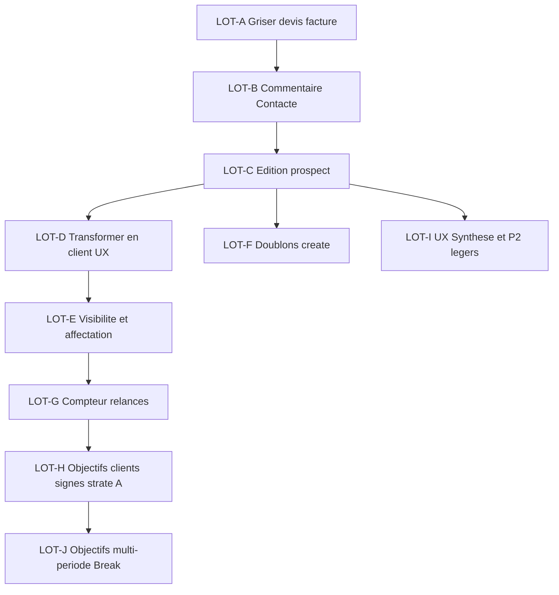

# Analyse post-démo Direction — CRM commercial

**Date analyse :** 14 octobre 2026  
**Source métier :** [`docs/rapport-reunion-direction-demo-erp-2026-10-13.md`](../rapport-reunion-direction-demo-erp-2026-10-13.md)  
**Discipline technique :** [`REGLES-EVOLUTION-CRM.md`](./REGLES-EVOLUTION-CRM.md) · [`FLOW-COMMERCIAL-E2E.md`](./FLOW-COMMERCIAL-E2E.md)  
**Branche :** `dev`  
**Nature :** analyse Keep / Change / Break — **aucune implémentation dans ce document**

---

## 0. Cadre

### 0.1 Méthode

```
Analyser → Samba lit / précise → GO lot → coder → tester → gate → lot suivant
```

- Pas de second module commercial.
- UI-first si ça suffit (0 migration).
- Break schéma uniquement via fiche §0bis REGLES + GO humain.
- Données test `[TEST]` / `*@test.msk.local` — jamais de vrais prospects en seed.

### 0.2 Vocabulaire code ↔ métier

| Métier Direction | Modèle / code |
|------------------|---------------|
| Prospect | `CrmOrganization` + `CrmOpportunity` |
| Contact | `CrmContact` |
| Relance | `CrmTask` (+ date `followUpAt` sur deal) |
| Journal | `CrmActivity` |
| Client signé | `ComClient` |
| Devis / Facture | `ComQuote` / `ComInvoice` |
| Affectation | `ownerId` (org + deal) — pas de table Assignment |
| Logs admin | `AuditLog` + `writeAudit()` |

### 0.3 Verdict global plateforme

Le flux **prospect → client → devis → facture → paiement** est déjà livré (Phases 2–3 + lots CRM/COM).  
La Direction valide le cœur ; elle demande de **fermer devis/facture**, de **durcir la discipline terrain**, et de **clarifier la fin de parcours** jusqu’au client signé.

---

## 1. Matrice gap — backlog Direction ↔ existant

Légende verdict :

| Verdict | Sens |
|---------|------|
| **Keep** | Conserver tel quel |
| **Change** | Évoluer (UI et/ou colonnes additives) |
| **Break** | Rupture modèle — exige fiche §0bis + GO |
| **Keep + Change UX** | Pont/schéma OK ; UX à ajuster |

Effort : **S** &lt; 0,5 j · **M** 0,5–2 j · **L** &gt; 2 j (ordre de grandeur).

### 1.1 P0 — Immédiat / bloquant discipline

| # | Item Direction | État code | Verdict | Effort | Dépendances |
|---|---------------|-----------|---------|--------|-------------|
| P0-1 | Griser devis & facture | Live dans hub/nav (`COMMERCIAL_MODULES` ids `devis`/`factures`, `com.access`, **pas** `soon`) | **Change** UI | S | Message Direction ; garde URL |
| P0-2 | Commentaire obligatoire → « Contacté » | `updateOpportunityStageAction` : CONTACTE exige **date de relance** GUIDE, **pas** de commentaire | **Change** | M | `StageForm` + `CrmActivity` |
| P0-3 | Édition prospect | Aucune `updateProspect*` ; fiche lecture seule (sauf stage / journal / devis) | **Change** | M–L | Page `/edit` ; droits ; `list-create-separation` |

### 1.2 P1 — Parcours commercial Direction

| # | Item Direction | État code | Verdict | Effort | Dépendances |
|---|---------------|-----------|---------|--------|-------------|
| P1-1 | Bouton « Transformer en client » | `convertOpportunityToClientAction` existe ; UI via `ProspectQuoteCta` (parcours devis) | **Keep pont** + **Change UX** | S–M | Griser devis (CTA indépendant) |
| P1-2 | Objectifs clients signés + sem/mois/an | Metrics : `NEW_PROSPECTS` / `FIRST_CONTACTS` / `MEETINGS` / `FOLLOW_UPS` ; cibles « hebdo » permanentes ; unique `(scope,userId,metric)` | **Change** (métrique) → **Break** si multi-période en DB | L | `CrmWeeklyGoal`, `week-stats`, UI objectifs |
| P1-3 | Compteur historique relances (1×, 2×…) | Dashboard = tâches OPEN à venir / retard ; **pas** de N× sur fiche | **Change** | M | Définir « 1 relance » (task DONE vs activity) |
| P1-4 | Visibilité partagée + affectation admin | Scope `own`/`team`/`global` ; create = owner = self ; `crm.reassign` **sans UI** | **Change** | M | Décision Direction §3.1 |
| P1-5 | Doublons create (nom/tél/mail/RS) + journal si ignore | Import skip `normalizedName` ; create **sans** check | **Change** | M–L | Édition ; index tél/email |

### 1.3 P2 — Enrichissement & UX

| # | Item Direction | État code | Verdict | Effort | Dépendances |
|---|---------------|-----------|---------|--------|-------------|
| P2-1 | Réseaux sociaux fiche + création | `website` + `source` origine ; **pas** d’URLs TikTok/IG/LinkedIn | **Change** additif | M | Create/edit ; doublons RS |
| P2-2 | Note / résumé entreprise (vs doublon Contact) | `notes` org existe ; bandeau Contact principal + section Contacts | **Change** UX layout | S | Édition notes |
| P2-3 | Multi-contacts / multi-téléphones | Schéma N contacts **Keep** ; create = 1 seul ; pas de CRUD | **Change** UX | M | Édition ; convert (primary only) |
| P2-4 | Secteurs liste + « Autre » | `sector` string libre | **Change** | S–M | Constante ou settings |
| P2-5 | Offres liées config catalogue | `optionSchema` / `SCHEMA_RS` **déjà là** | **Keep** (+ polish) | — | Seed SKU |
| P2-6 | Calendrier filtres rapports + compare mois | Select semaines prédéfinies (`listWeekOptions`) | **Change** | M–L | Couplé P1-2 |
| P2-7 | Clarifier UX « Synthèse » | Plusieurs libellés « Synthèse » / « Synthèse équipe » / bouton retour sur `/crm/objectifs` | **Change** UI | S | — |
| P2-9 | Libellé Qualification → « En discussion » + aide | `QUALIFICATION` peu compris terrain (Samba 14/10) | **Change** UI labels | S | LOT-I / polish — **après** LOT-B |
| P2-8 | Logs admin toutes actions | `AuditLog` + `writeAudit` partiel ; UI = audits d’un user admin | **Change** couverture + UI | M | `audit.view` |

### 1.4 Hors scope cette vague (rappel)

- RH / paie (synthèse 11/10) — phase séparée  
- Signature électronique contrat  
- Numérotation définitive devis/facture + règles compta (prérequis pour **réouvrir** devis)  
- Import bulk clients / merge orgs avancé  
- Phase 8 automations  

---

## 2. Analyse approfondie P0

### 2.1 P0-1 — Griser devis & facture

**Pourquoi Direction :** process devis hors plateforme pour l’instant ; numérotation + lien comptable non figés.

**Fichiers :**

| Fichier | Rôle |
|---------|------|
| [`src/lib/commercial/modules.ts`](../../src/lib/commercial/modules.ts) | Cards hub Devis / Factures |
| [`src/lib/commercial/nav.ts`](../../src/lib/commercial/nav.ts) | Sous-nav Commercial |
| [`src/components/commercial/commercial-hub-cards.tsx`](../../src/components/commercial/commercial-hub-cards.tsx) | Rendu cards |
| [`src/components/crm/prospect-quote-cta.tsx`](../../src/components/crm/prospect-quote-cta.tsx) | CTA devis depuis fiche prospect |
| Routes `src/app/(app)/commercial/devis/**`, `factures/**` | Accès direct URL |

**Approche retenue (UI-first, 0 migration) :**

1. Ajouter un flag produit du type `gated: true` (ou réutiliser pattern `soon`) sur modules `devis` / `factures`.
2. Hub : card grisée + libellé clair (« bientôt — numérotation / compta ») — **pas** de navigation.
3. Sous-nav : masquer ou griser Devis / Factures.
4. Garde serveur sur pages devis/facture : `redirect` vers `/commercial` avec message (anti-accès URL).
5. Sur fiche prospect : **retirer / griser** CTA « Créer un devis » ; **conserver** un CTA « Transformer en client » (P1-1).
6. **Ne pas** supprimer schéma, actions, ni pont `ComClient`/`ComQuote` — Keep critique REGLES §4.

**Risques :**

- Commercial qui bookmark `/commercial/devis` → garde serveur obligatoire.  
- Régression COM-6 bridge facture→VE : code reste, usage terrain gelé.  
- Droits `com.access` inchangés ; flag produit ≠ permission.

**Critères gate lot :**

- [x] Hub : Devis/Factures non cliquables, message Direction visible  
- [x] Nav Commercial sans entrée active devis/facture  
- [x] Accès URL `/commercial/devis` → redirect  
- [x] Clients + Catalogue + Prospects restent accessibles  
- [x] Convert client possible **sans** ouvrir devis  

**Statut :** **LOT-A OK** (2026-10-14) — flag `COM_DOCS_GATED` · push `dev` + `main`.

---

### 2.2 P0-2 — Commentaire obligatoire au passage « Contacté »

**Pourquoi Direction :** cas Madina — « contacté » sans savoir comment ni quoi échangé.

**État :**

- Action : `updateOpportunityStageAction` ([`src/actions/crm.ts`](../../src/actions/crm.ts))  
- GUIDE : `followUpRequiredForStage` → CONTACTE exige `followUpAt`, **pas** de body commentaire  
- UI : `StageForm` dans [`src/components/crm/stage-form.tsx`](../../src/components/crm/stage-form.tsx)

**Approche retenue (Change) :**

1. Si nouveau stage = `CONTACTE` : champ commentaire **obligatoire** (Zod `min(1)`), UI rouge / bloquant.
2. Contenu attendu (aide placeholder) : canal (appel, WhatsApp…) + ce qui a été dit / ou « pas de réponse ».
3. Même mutation : créer une `CrmActivity` (type adapté : APPEL / WHATSAPP / AUTRE selon choix, ou NOTE) avec le texte.
4. `writeAudit` sur le changement de stage + activité.
5. Ne pas exiger le même commentaire pour les autres transitions (sauf si Direction élargit plus tard).

**Risques :**

- Contournement : passer CONTACTE → autre statut sans repasser CONTACTE — OK.  
- Import CSV : ne pas forcer rétroactivement les CONTACTE existants.  
- Double saisie si l’utilisateur a déjà loggé une activité juste avant — acceptable vs discipline.

**Critères gate :**

- [ ] Passage Contacté sans commentaire → erreur UI + serveur  
- [ ] Avec commentaire → stage OK + ligne journal visible  
- [ ] Autres changements de statut inchangés (sauf GUIDE relance)  

**Décisions à confirmer :**

- Canal obligatoire (select) ou libre dans le texte ?  
- Appliquer aussi à QUALIFICATION / INTERESSE ?

---

### 2.3 P0-3 — Édition d’un prospect

**Pourquoi Direction :** fautes de saisie ; récupérer un lead « perdu » (données).

**État :** fiche [`/crm/prospects/[id]`](../../src/app/(app)/crm/prospects/[id]/page.tsx) lecture seule pour identité ; create = [`createProspectAction`](../../src/actions/crm.ts) seulement.

**Approche retenue (Change, schéma Keep) :**

1. Page dédiée `/crm/prospects/[id]/edit` (règle `list-create-separation` — **pas** de form inline sur la liste).
2. CTA « Modifier » sur la fiche → Link vers edit.
3. Actions : `updateProspectOrganizationAction` (+ contacts / offres selon périmètre lot).
4. Champs lot minimal : nom, secteur, ville, pays, website, notes, source, contact primaire (nom, poste, tél, email), budget, prochaine action.
5. Recalcul `normalizedName` à l’enregistrement ; droits : owner **ou** `crm.reassign` / team lead / global.
6. Journal / audit : « fiche modifiée » (champs touchés en metadata).

**Hors lot minimal (→ P2 / lots suivants) :** multi-contacts CRUD, réseaux sociaux, offres N:N post-création.

**Risques :**

- Édition hors scope own → fuite / sabotage data.  
- Changement de nom sans alerte doublon (coupler P1-5 idéalement après ou dans même vague).  
- Sync `ComClient` déjà lié : ne **pas** auto-écraser le client (documenter ; sync manuelle ou plus tard).

**Critères gate :**

- [x] Page `/edit` + CTA Modifier + `updateProspectAction`  
- [x] Formulaire pleine largeur charte  
- [x] Droits owner / team / reassign / direction  
- [ ] Smoke UI `[TEST]` (pending + redirect) — à confirmer terrain  

**Décisions figées :** offres N:N reportées P2/LOT-L · éditeurs = owner + admin CRM / direction (`crm.reassign` / team / global).

---

## 3. Analyse approfondie P1

### 3.1 P1-1 — Bouton « Transformer en client »

**État :** pont solide `convertOpportunityToClientAction` ([`src/actions/commercial.ts`](../../src/actions/commercial.ts)).

- Stages : `INTERESSE` | `DEVIS_ENVOYE` | `GAGNE` (+ NEGOCIATION mappé)  
- Copie org + contact primaire → `ComClient` + dossier GED  
- Idempotent si déjà lié  
- UI actuelle : convert **au service du devis** (`ProspectQuoteCta`)

**Approche (Keep pont + Change UX) :**

1. Bouton explicite « Transformer en client » sur fiche prospect (et éventuellement liste si stage OK).
2. Indépendant du CTA devis (surtout une fois devis grisé).
3. Après succès : `redirect` vers fiche client `/commercial/clients/[id]` (ou rester sur prospect avec badge Client — à trancher).
4. Option : passer le deal en `GAGNE` + `wonAt` lors de la conversion (aujourd’hui **non** auto) — **décision métier**.

**Risques :** casser le pont = régression COM-4/5 (interdit sans GO Break).

**Décisions :** redirect cible ; auto-stage GAGNE oui/non ; stages autorisés (garder INTERESSE+ ou seulement « prêt à signer ») ?

---

### 3.2 P1-2 — Objectifs : clients signés + périodes

**État :**

- [`CrmWeeklyGoal`](../../prisma/schema.prisma) : unique `(scope, userId, metric)` — cible permanente, stats calculées sur **semaine courante**  
- Metrics actuelles dans [`src/lib/crm/goals.ts`](../../src/lib/crm/goals.ts)  
- UI [`/crm/objectifs`](../../src/app/(app)/crm/objectifs/page.tsx)

**Écart Direction :**

1. Métrique **clients signés / conversions** (ex. 3 clients / an)  
2. Périodes **semaine / mois / année** (pas seulement hebdo implicite)  
3. Comparer deux mois (animation commerciale)

**Approche en deux strates :**

| Strate | Contenu | Verdict |
|--------|---------|---------|
| A (rapide) | Ajouter metric `CLIENTS_SIGNED` (count `ComClient` créés ou `wonAt` dans la fenêtre) ; garder modèle hebdo | **Change** additif enum métier (string metric) |
| B (Direction complète) | Introduire `periodType` + `periodStart` (ou table goals par période) ; casser unique actuel | **Break** modèle — fiche §0bis |

**Recommandation analyse :** livrer strate A dans un lot P1 ; planifier strate B en lot dédié après GO Break (coût migration + UI calendrier + comparaison).

**Risques :** double définition « client signé » (création `ComClient` vs stage GAGNE vs signature contrat absente) — **trancher** avant code.

**Décision critique :** un client signé = `ComClient.createdAt` dans la période · ou `opportunity.wonAt` · ou date contrat (pas encore en CRM) ?

---

### 3.3 P1-3 — Compteur historique de relances

**État :** dashboard compte tâches OPEN ; objectifs `FOLLOW_UPS` = tasks DONE dans la semaine ; **pas** de « déjà relancé 3 fois » sur fiche/liste.

**Approche (Change) :**

1. Définir : **1 relance comptée** = `CrmTask` passée DONE **ou** activité typée relance (à créer) — recommandation : compter les **activités** de suivi (APPEL/WHATSAPP/… hors NOTE pure) **ou** tasks DONE liées au deal, documenté clairement.
2. Afficher sur fiche + éventuellement liste / dashboard : badge `Relancé 3×`.
3. Ne pas confondre avec « jours de retard » (déjà présent).

**Décision :** source de vérité task vs activity (éviter double comptage).

---

### 3.4 P1-4 — Visibilité partagée + affectation

**Demande Direction (consensus) :**

1. Tous les commerciaux **voient** tous les prospects  
2. **Modifier / interagir** seulement si affecté  
3. Affectation = **admin / direction** (pas auto-service)  
4. Variante : commercial peut **demander** à être affecté

**État :** `crmVisibility()` own/team/global ([`src/lib/crm/scope.ts`](../../src/lib/crm/scope.ts)) ; pack commercial = souvent `own` → ne voit que soi.

**Approche (Change — impact RBAC fort) :**

| Couche | Cible |
|--------|-------|
| Lecture liste/fiche | Élargir pack `commercial` : lecture **team/global** sur orgs/deals CRM |
| Mutation (stage, activity, edit) | Restreindre à `ownerId === actor` **sauf** `crm.reassign` / direction |
| Affectation | UI admin/direction « Changer le suivi » (permission `crm.reassign` déjà au catalogue) |
| Demande d’affectation | Lot ultérieur (ticket / notification) — **hors P1 minimal** |

**Fiche décision (pas Break schéma ; Change droits + UI) :**

> Remplacer le mental model « own = invisible aux autres » par « shared read / owned write ».  
> Impact : Yaye voit les dossiers Madina (lecture) ; ne peut pas journaliser dessus sans affectation.

**Risques :** fuite commerciale interne (acceptée par Direction) ; sync `organization.ownerId` vs `opportunity.ownerId` (réassigner les deux).

**Décisions :** lecture pour tous les packs `commercial` dès maintenant ? Demande d’affectation dans le même lot ou plus tard ?

---

### 3.5 P1-5 — Détection doublons à la création

**État :** `normalizedName` indexé, check **import only** ; create écrit sans garde.

**Critères Direction :** nom flou · téléphone · email · réseaux (si renseignés).

**Approche (Change) :**

1. Wizard étape entreprise : avant next, API/action `findDuplicateCandidates`.  
2. Similarité nom (normalisé + éventuellement fuzzy simple) ; match exact phone/email.  
3. UI : liste candidats + « Continuer quand même » / « Ouvrir l’existant ».  
4. Si ignore : `CrmActivity` ou audit « doublon possible détecté / ignoré » + metadata ids candidats.  
5. Serveur : même check (ne pas se fier au seul client).

**Risques :** faux positifs (« MSK », « MSK Creation ») ; perf ; contournement humain (Isdalinia : itérer).

**Dépendance :** champs RS (P2-1) pour critère réseaux — phase 1 doublons = nom + tél + email.

---

## 4. Analyse approfondie P2

### 4.1 P2-1 — Réseaux sociaux

Colonnes additives nullable sur `CrmOrganization` (ex. `instagramUrl`, `linkedinUrl`, `tiktokUrl`, `facebookUrl`) — **pas** de JSON fourre-tout (REGLES §3.2).  
Fiche : badges cliquables ; create : lignes « a / n’a pas » pour pousser la recherche.

### 4.2 P2-2 — Note / résumé entreprise

`notes` existe. Change UX : remplacer / alléger le doublon visuel Contact en bas de fiche par un bloc « Résumé entreprise » mis en avant ; clarifier libellé create (« Notes internes » → plus explicite).

### 4.3 P2-3 — Multi-contacts

Keep schéma N `CrmContact`. Change : sections ADD à la création + CRUD sur edit ; cas 2 numéros / même personne = lignes téléphone (ou 2 contacts liés) — trancher UX (préférence Direction : `+` sur tél sans dupliquer le nom).

### 4.4 P2-4 — Secteurs liste + Autre

Constante métier MSK (ou table settings) + option Autre + précision obligatoire. Migration douce : valeurs libres existantes restent affichables ; nouvelle saisie = liste.

### 4.5 P2-5 — Offres liées catalogue

**Keep** `optionSchema` / `SCHEMA_RS` ([`src/lib/crm/offer-option-schemas.ts`](../../src/lib/crm/offer-option-schemas.ts)). Polish labels / seed si besoin. Ne pas confondre options offre ≠ handles entreprise (P2-1).

### 4.6 P2-6 — Calendrier rapports + comparaison mois

Change filtres `rapport-semaine` / éventuel rapport mensuel. Couplé fortement à P1-2 strate B. Peut rester dette si Break goals non GO.

### 4.7 P2-7 — UX Synthèse

Fichiers : [`src/app/(app)/crm/objectifs/page.tsx`](../../src/app/(app)/crm/objectifs/page.tsx) — libellés « Synthèse », « Synthèse équipe », « Retour synthèse », `clearLabel="Synthèse"`.

**Change :** retirer les libellés ambigus ; le `backHref` suffit ; clarifier switch perso ↔ équipe (« Vue personnelle » / « Objectifs équipe » / « Assignation globale »).

Effort S — candidat lot UX rapide.

### 4.8 P2-8 — Logs admin

Keep `AuditLog`. Change : instrumenter stage, edit, convert, ignore-doublon, réassign ; page admin « Journal CRM » filtrable (pas seulement audits d’un user).

---

## 5. Découpage en lots d’implémentation

Ordre proposé — **un plan Cursor dédié + GO Samba avant chaque lot**.  
Pas d’implémentation tant que le plan de lot n’est pas validé.

### 5.1 Ordre recommandé



### 5.2 Fiches lots

| Lot | Items | Migrations | Prérequis | Gate focus |
|-----|-------|------------|-----------|------------|
| **LOT-A** | P0-1 Griser devis/facture | Non | Décision message + exceptions | Hub/nav/URL ; convert sans devis — **implémenté 2026-10-14** (`COM_DOCS_GATED`) |
| **LOT-B** | P0-2 Commentaire Contacté | Non | — | Stage Contacté bloquant + journal — **implémenté 2026-10-14** |
| **LOT-C** | P0-3 Édition prospect (champs cœur) | Non | Droits edit | `/edit` + audit ; pas multi-contacts — **implémenté 2026-10-14** |
| **LOT-D** | P1-1 Transformer en client | Non | LOT-A (CTA devis mort) | Bouton fiche ; pont intact — **implémenté 2026-10-14** (auto GAGNE + confirm) |
| **LOT-E** | P1-4 Visibilité + réassign UI | **OK** 2026-10-14 | shared-read / owned-write | Yaye voit Madina ; mute si non owner |
| **LOT-F** | P1-5 Doublons create | Index additifs possibles | LOT-C idéal | Alerte wizard + journal si ignore |
| **LOT-G** | P1-3 Compteur relances | Non ou compteur dérivé | Définition métier | Badge N× fiche + dashboard |
| **LOT-H** | P1-2 strate A `CLIENTS_SIGNED` | Non (metric string) | Définition « signé » | Objectif + progression semaine |
| **LOT-I** | P2-7 Synthèse + P2-9 « En discussion » + P2-2 + P2-4 | **OK** 2026-10-14 | Après LOT-B | UX Direction claire |
| **LOT-J** | P1-2 strate B + P2-6 périodes | **Oui — Break** | Fiche §0bis + GO | Mois/année + compare |

**Lots P2 reportés (après I ou parallèle) :**

| Lot | Items |
|-----|-------|
| **LOT-K** | P2-1 Réseaux sociaux org |
| **LOT-L** | P2-3 Multi-contacts CRUD |
| **LOT-M** | P2-8 Console logs admin CRM |
| **LOT-N** | P2-5 polish catalogue (si besoin terrain) |

### 5.3 Ce que chaque plan de lot devra contenir

1. Périmètre exact (in / out)  
2. Fichiers touchés  
3. Keep/Change/Break + migration si besoin  
4. Checklist gate (build + parcours UI + droits)  
5. Données `[TEST]` uniquement  
6. Maj manuels `docs/manuels/05-crm.md` / `06-commercial.md` si UX user-facing  

### 5.4 Mise à jour priorités produit

Cette vague **POST-DEMO-CRM** s’intercale **avant** la reprise Phase RH Direction (11/10) pour le pôle commercial, sans annuler RH :  
Commercial discipline (cette analyse) → puis RH SPEC → Phase 8 plus tard.

Voir aussi [`PRIORITES.md`](./PRIORITES.md) (à aligner lors du premier lot GO).

---

## 6. Décisions ouvertes (à trancher avant les lots concernés)

| ID | Question | Lots bloqués | Proposition analyse |
|----|----------|--------------|---------------------|
| D1 | Griser : exception Super Admin / Direction lecture seule ? | A | **Non** — même blocage pour tous (évite écarts numérotation) |
| D2 | Commentaire Contacté : canal en select obligatoire ? | B | Select canal + texte libre (discipline Madina) |
| D3 | Édition : owner seul ou aussi admin CRM ? | C | Owner + `crm.reassign` / direction |
| D4 | Convert → auto stage `GAGNE` ? | D | **Oui** + `wonAt` (fermeture parcours) |
| D5 | Client signé pour objectifs = ? | H, J | `ComClient.createdAt` dans la période (simple, aligné bouton Transformer) |
| D6 | Shared read pour tout pack `commercial` dès LOT-E ? | E | **Oui** — conforme consensus Andile/Mathieu |
| D7 | Demande d’affectation commercial ? | E | **Hors** LOT-E ; lot ultérieur |
| D8 | Break goals multi-période maintenant ? | J | **Après** strate A (H) + GO §0bis explicite |
| D9 | Relance comptée = task DONE ou activités ? | G | Activités de contact (APPEL/WA/…) + tasks DONE « Relance » — documenter une seule règle dans le plan G |

---

## 7. Risques transverses

| Risque | Mitigation |
|--------|------------|
| Régression pont Client/Devis en grisant | Ne pas supprimer code ; tests convert + clients |
| Scope creep édition + multi-contacts + RS | LOT-C minimal ; K/L séparés |
| Contournement humains (Isdalinia) | Commentaires + doublons + audit — itérer |
| Pollution schéma | REGLES §3 ; pas de meta JSON fourre-tout |
| Confusion priorités RH vs CRM | Cette vague = POST-DEMO-CRM documentée ; RH ensuite |

---

## 8. Synthèse exécutive analyse

| Axe | Conclusion |
|-----|------------|
| Qualité existante | Cœur CRM/COM **solide** — on évolue, on ne réécrit pas |
| P0 | 3 Changes UI/règles — **0 Break** |
| P1 | Pont convert Keep ; objectifs multi-période = seul **Break** potentiel (LOT-J) |
| P2 | Majorité Change additif / UX ; catalogue RS **Keep** |
| Premier lot à planifier | **LOT-A Griser devis/facture** (après précisions D1) |

**Prochaine action humaine :** relire ce document → préciser D1–D9 utiles → donner **GO LOT-A** (plan d’implémentation dédié) ou demander des ajustements d’analyse.

---

*Document d’analyse — pas une gate d’implémentation. Aucun lot « OK » sans plan + code + tests.*
